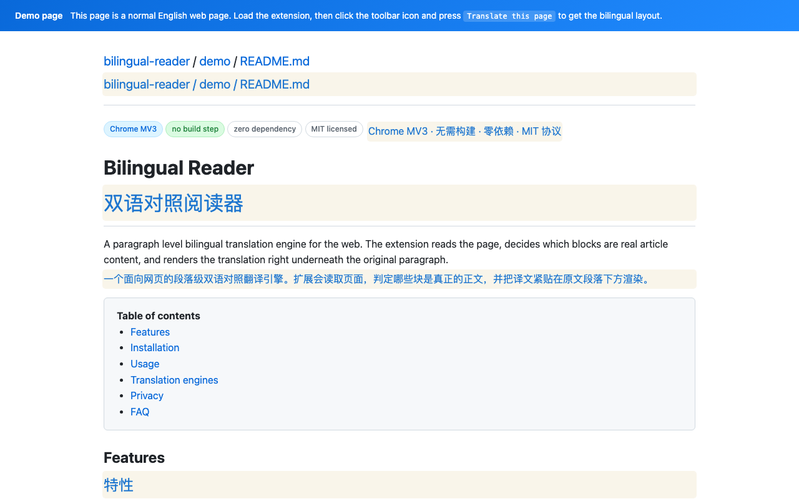
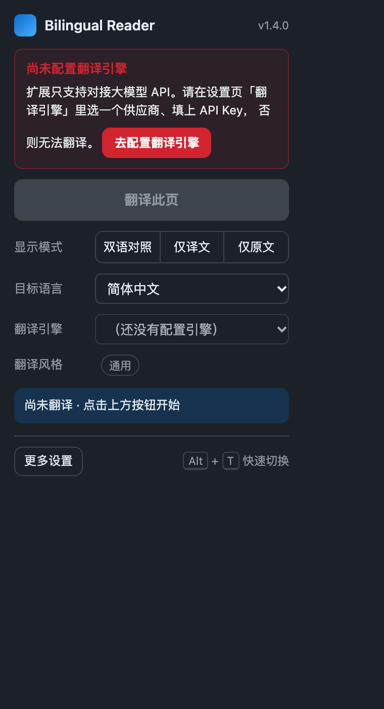
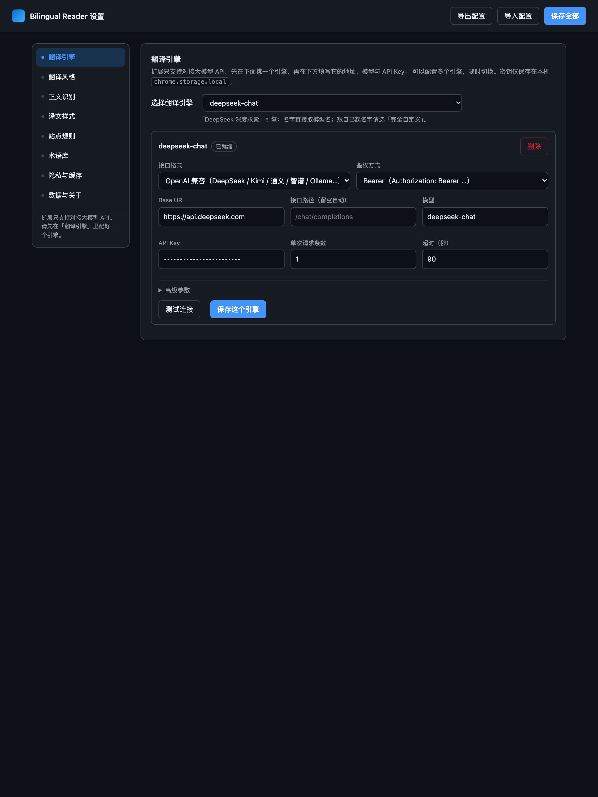

# Bilingual Reader

[English](README.md) | [简体中文](README.zh-CN.md) | [日本語](README.ja.md) | [한국어](README.ko.md) | **Español**

**Lee las páginas web con el texto original y su traducción, párrafo a párrafo.**

Bilingual Reader es una extensión de Chrome que identifica el contenido de una página y muestra la traducción junto a cada párrafo original. Traduce títulos, listas y celdas de tablas, mientras conserva los bloques de código. Utiliza la API del modelo que configures o un modelo alojado en tu equipo.

No necesita compilación, instalación con npm ni un entorno de ejecución de terceros. La interfaz de la extensión está actualmente, en su mayor parte, en chino simplificado; estas traducciones del README describen la misma extensión.

[Sitio web](https://xuyang1996.github.io/bilingual-reader/es/) · [Descargas](https://github.com/xuyang1996/bilingual-reader/releases) · [Política de privacidad](https://xuyang1996.github.io/bilingual-reader/privacy.html) · [Informar de un problema](https://github.com/xuyang1996/bilingual-reader/issues)

## Vista previa



| Panel de la barra de herramientas | Configuración |
| --- | --- |
|  |  |

## Funciones

- **Lectura bilingüe:** alterna entre original y traducción, solo traducción o solo original; restaura la página al terminar.
- **Reconocimiento del contenido:** omite por defecto menús, barras laterales, pies de página y otros elementos de navegación. Puedes ajustar el alcance con reglas por sitio.
- **Traducción diferida:** solicita los párrafos cercanos al área visible en lugar de enviar toda la página de una vez.
- **Contenido dinámico:** con la traducción incremental activada, también traduce los elementos nuevos.
- **Tu propio modelo:** configura varios proveedores, pasarelas propias o servidores locales.
- **Estilos de traducción:** 14 escenarios integrados, instrucciones editables y selección automática según la URL.
- **Terminología y privacidad:** instrucciones de glosario, procesamiento posterior y enmascaramiento opcional de datos sensibles.
- **Configuración y caché locales:** guarda los ajustes y las traducciones en el navegador; importa y exporta la configuración en JSON.

## Primeros pasos

1. Descarga **`bilingual-reader.zip`** desde [Releases](https://github.com/xuyang1996/bilingual-reader/releases) y descomprímelo, o clona este repositorio.
2. Abre `chrome://extensions` y activa el **Modo de desarrollador**.
3. Selecciona **Cargar descomprimida** y elige la carpeta que contiene `manifest.json`: el directorio `bilingual-reader` extraído o la raíz del repositorio.
4. Abre los ajustes de la extensión. En **Motores de traducción (`翻译引擎`)**, selecciona un proveedor e introduce la URL de su API, el modelo y la clave. Pulsa **Probar conexión (`测试连接`)** y después **Guardar este motor (`保存这个引擎`)**.
5. Abre una página web normal y pulsa el icono de la extensión → **Traducir esta página (`翻译此页`)**.
6. Selecciona el idioma de destino en el panel. El predeterminado es chino simplificado; la lista incluye 17 idiomas de destino.

Una instalación nueva **no tiene ningún motor configurado**. La traducción real necesita un servicio de modelos que funcione. La extensión no proporciona un servicio de traducción alojado ni créditos de API. El proveedor puede cobrar por las solicitudes.

### Probar sin clave de API

En los ajustes, añade **Modo de demostración (`演示模式（本地示例，无需 Key）`)** y guárdalo. Abre la [página de demostración en inglés](https://xuyang1996.github.io/bilingual-reader/demo.html) e inicia la traducción.

Este modo utiliza un diccionario incluido y no realiza solicitudes de red. Las traducciones aparecen sobre un fondo amarillo claro. Sirve para probar el reconocimiento, el diseño, los modos de visualización y la restauración; **no es traducción automática real**.

### Atajos y menú contextual

| Acción | Atajo predeterminado |
| --- | --- |
| Traducir / restaurar la página actual | `Alt+T` |
| Iniciar la traducción | `Alt+Shift+T` |
| Restaurar la página | `Alt+Shift+R` |

Puedes cambiarlos en `chrome://extensions/shortcuts`. El menú contextual de la página también ofrece traducir, restaurar, mostrar solo la traducción y mostrar solo el original.

## Conectar la API de un modelo

El selector incluye preajustes para OpenAI, Anthropic Claude, Google Gemini, DeepSeek, Kimi, Qwen, GLM, OpenRouter y otros proveedores. Los preajustes locales incluyen Ollama, vLLM y LM Studio.

| Interfaz | Configuración |
| --- | --- |
| Compatible con OpenAI | URL base, ruta opcional, modelo y autenticación |
| Anthropic Messages | Formato de solicitud y autenticación de Anthropic |
| Gemini generateContent | Formato de Gemini, ruta del modelo y opciones de la clave |
| Personalizada / pasarela | Ruta, cabeceras, parámetros adicionales del cuerpo y ruta del campo de respuesta |
| Modelo local | URL del servidor local y modelo; usa autenticación sin clave solo si el servidor lo permite |

Los valores sugeridos aparecen como indicaciones: introduce los que requiera tu servicio. Los motores de preajuste toman el nombre del modelo. Elige **Totalmente personalizado (`完全自定义`)** para poner un nombre propio y único, por ejemplo si quieres usar el mismo modelo a través de distintas pasarelas.

La capa de motores gestiona URLs alternativas (como la ausencia de `/v1`), alternativas de autenticación, varias estructuras de respuesta y SSE. Recuerda las combinaciones de URL y autenticación que funcionan. Si no puede alinear la respuesta de un lote numerado, recurre a solicitudes individuales. Algunas opciones de modelos de razonamiento se ajustan según su nombre; la compatibilidad real sigue dependiendo del servicio.

Las opciones avanzadas incluyen autenticación, rol system/developer/user, tiempo de espera, tamaño del lote, temperature, límite de tokens de salida, cabeceras, cuerpo JSON adicional, ruta de respuesta e instrucciones del sistema. El [banco local de pruebas de API](test/engine.html) muestra los detalles de las solicitudes y respuestas; fuera de la extensión pueden aplicarse las restricciones CORS del navegador.

Si falla la traducción, el panel muestra el error de la API. Corrige el modelo, la autenticación o la cuota en los ajustes y pulsa **重试失败段落** (reintentar párrafos fallidos). Se conservan las traducciones correctas. Los errores temporales de red o de la API se reintentan un máximo de dos veces; los errores de modelo, de dirección o del servicio persistentes detienen las solicitudes siguientes. Consulta las [notas de recuperación](docs/RELIABILITY.zh-CN.md) (en chino).

## Estilos de traducción

| Escenario | Prioridad |
| --- | --- |
| General | Traducción fiel y concisa |
| Tecnología / software | Terminología técnica y nombres de productos |
| Noticias / medios | Hechos, citas y atribución |
| Artículos académicos | Fórmulas, referencias y fuerza de las afirmaciones |
| Documentación de programación | APIs, comandos e identificadores |
| GitHub | Issues, pull requests, Markdown y código |
| Jurídico | Términos definidos y referencias legales |
| Medicina / salud | Terminología médica, cantidades y unidades |
| Finanzas | Números, porcentajes y términos financieros |
| Comercio electrónico | Marcas, especificaciones y condiciones de compra |
| Atención al cliente | Mantener el tono y la responsabilidad sin añadir compromisos |
| Ficción | Voz, ritmo y estilo narrativo |
| Redes sociales | Lenguaje informal, menciones y etiquetas |
| Inglés sencillo | Reescribir textos difíciles en un inglés más sencillo |

La selección automática por URL está activada por defecto. Un escenario que coincida tiene prioridad sobre el seleccionado manualmente. Puedes editar las instrucciones integradas o añadir escenarios propios. `{target}` se sustituye por el nombre del idioma de destino.

Las instrucciones del sistema personalizadas de un motor sustituyen al escenario y a las reglas generales. Si no las defines, las instrucciones del escenario se añaden a las reglas generales. Después se añaden el protocolo por lotes, cuando se utiliza, y las instrucciones del glosario.

## Reglas por sitio y glosario

Introduce un arreglo JSON en **Reglas por sitio (`站点规则`)** para elegir el selector del contenido principal, excluir elementos, cambiar idiomas o modos de visualización y ajustar los umbrales de reconocimiento. Admite comodines de URL, coincidencia de dominio con `||example.com` y herencia con `parentId`. Las reglas coincidentes más específicas se aplican después.

```json
[
  {
    "id": "docs-site",
    "name": "Documentation",
    "urlPattern": ["*docs.example.com*"],
    "translationMode": "dual",
    "targetLang": "zh-Hans",
    "mainSelector": "main",
    "excludeSelectors": [".sidebar", "nav", ".advertisement"],
    "thresholds": { "paragraphMinTextCount": 2 }
  }
]
```

La longitud mínima predeterminada de un párrafo es de 2 caracteres; el umbral de contenido de la página es de 50. **Traducir toda la página (`整页翻译`)** incluye los elementos de navegación que normalmente se omiten. Los fragmentos técnicos en línea se protegen con marcadores; los bloques de código independientes se excluyen.

El glosario acepta una pareja de término original y traducción por línea, separados por una tabulación o una coma. Por ejemplo:

```text
large language model,modelo de lenguaje de gran tamaño
pull request,solicitud de incorporación de cambios
```

Los términos se añaden a las instrucciones del modelo. El procesamiento posterior también sustituye los términos originales que queden, pero no garantiza corregir traducciones que ya utilicen otro término de destino.

## Privacidad y almacenamiento

- El desarrollador no opera un servidor que reciba el texto de las páginas, las claves de API o estadísticas de uso. No hay SDK de publicidad ni de telemetría.
- La traducción real envía el texto procesado, las instrucciones y los datos de autenticación **directamente al servicio que configures**. Se aplican las políticas de su operador. Usa un servicio de confianza y HTTPS para conexiones remotas.
- El enmascaramiento opcional cubre correos, teléfonos, números de tarjeta, números de identificación, direcciones IP, URLs e IBAN. Se basa en patrones y **no garantiza eliminar todos los datos sensibles**.
- Los ajustes, las claves y la caché se guardan en `chrome.storage.local`. Las claves de caché incluyen identificadores de texto, idiomas y motor; las entradas de más de 30 días caducan al leerse. Puedes desactivar o vaciar la caché.
- Las exportaciones de configuración JSON incluyen claves de API. Mantén las copias de seguridad en privado. Borra la caché y restablece los ajustes con sus respectivos controles, o desinstala la extensión para eliminar su almacenamiento local.
- Para procesar todo en tu equipo, usa el modo de demostración o un servidor de modelos alojado realmente en él. Seleccionar un preajuste “local” no determina por sí solo a dónde envía los datos una URL personalizada.

Consulta la [política de privacidad completa](https://xuyang1996.github.io/bilingual-reader/privacy.html).

## Arquitectura y desarrollo

La extensión utiliza Manifest V3, scripts JavaScript clásicos y el espacio de nombres compartido `IMT`. Los módulos principales no dependen de `chrome.*`; el transporte de traducción se inyecta para la extensión o para las pruebas.

| Ruta | Responsabilidad |
| --- | --- |
| `src/shared/` | Valores predeterminados, proveedores, utilidades, migración de ajustes e instrucciones |
| `src/core/` | Reglas, segmentación, planificación, enmascaramiento, glosario y representación |
| `src/content/` | Acciones en la página y conexión con el proceso en segundo plano |
| `src/background/` | Adaptadores de API, caché, mensajes, atajos y menús |
| `src/popup/`, `src/options/` | Panel de la barra de herramientas y ajustes |
| `test/` | Pruebas DOM, servidor de modelos simulado y scripts de verificación del navegador |
| `docs/` | Documentación, capturas y recursos de GitHub Pages |

El flujo es: **resolver reglas → recopilar párrafos → planificar → enmascarar → caché/API → restaurar marcadores → aplicar glosario → mostrar**. La restauración retira los envoltorios del original y elimina las traducciones insertadas. Los modos de visualización se controlan con clases CSS.

Después de editar, vuelve a cargar la extensión y actualiza la página web. Antes de cambios importantes, consulta la [guía de desarrollo](docs/DEVELOPMENT.md), los [requisitos del producto](docs/PRD.md) y las [notas técnicas detalladas originales](docs/README-technical.zh-CN.md). Estos documentos detallados están actualmente en chino.

### Verificación local

Con el repositorio en una carpeta llamada `bilingual-reader`, inicia un servidor estático y abre la página de pruebas DOM. Ejecuta los scripts del navegador en otra terminal desde la raíz del repositorio:

```bash
git clone https://github.com/xuyang1996/bilingual-reader.git
cd bilingual-reader
python3 -m http.server 8766 --bind 127.0.0.1 --directory ..
```

`http://127.0.0.1:8766/bilingual-reader/test/harness.html?autotest=1`

```bash
python3 test/e2e.py --ext . \
  --url http://127.0.0.1:8766/bilingual-reader/demo/demo.html \
  --out /tmp/bilingual-reader-e2e.png
python3 test/verify_ai.py --ext .
python3 test/verify_reliability.py --ext .
python3 test/verify_options.py --ext .
python3 test/verify_popup.py --ext . \
  --url http://127.0.0.1:8766/bilingual-reader/demo/demo.html
```

Ejecuta las pruebas del navegador **de forma secuencial**. Los scripts usan la biblioteca estándar de Python y la ruta predeterminada de Chrome en macOS; en otros entornos, indica `--chrome /path/to/chrome`. Las pruebas de formatos de API usan un servicio HTTP local simulado, no un proveedor de pago.

Verificación registrada el 2026-11-04: **67 pruebas DOM, 35 comprobaciones de formatos de API y 53 comprobaciones de ajustes superadas; pruebas del panel superadas; la extensión empaquetada tradujo 52 párrafos de demostración con 0 errores.** Son resultados registrados, no una garantía de disponibilidad actual de todos los proveedores.

Crea el archivo para Chrome Web Store con:

```bash
python3 test/build_store_zip.py --ext . --out ../bilingual-reader-store.zip
```

El ZIP de la tienda coloca `manifest.json` en la raíz y excluye pruebas, documentación e imágenes de la tienda. El archivo de fuentes incluye el proyecto completo bajo `bilingual-reader/`.

## Limitaciones y contribuciones

- Esta versión está dirigida a Chrome / Chromium con Manifest V3 (mínimo declarado: Chrome 96). No admite Firefox ni Safari.
- No puede traducir páginas internas de Chrome ni páginas de Chrome Web Store. Tampoco puede acceder a raíces shadow cerradas.
- Los cambios frecuentes de React/Vue pueden reemplazar las traducciones insertadas. El reconocimiento es heurístico; algunos sitios necesitan reglas específicas.
- Los límites, las cuotas, la autenticación y la disponibilidad dependen del proveedor. No todas las APIs admiten todas las opciones avanzadas.
- Al cambiar el modelo, el servicio, las instrucciones o el glosario, se utiliza automáticamente una caché de traducción separada.

Puedes informar de errores o contribuir mediante [Issues](https://github.com/xuyang1996/bilingual-reader/issues) y pull requests. Incluye la versión de Chrome, los pasos para reproducir el problema y una URL pública de ejemplo, si es posible. No incluyas claves de API ni contenido privado.

## Inspiración y agradecimientos

Este proyecto se inspira en **[Immersive Translate (沉浸式翻译)](https://immersivetranslate.com/)**. Los estilos de traducción utilizan instrucciones de escenarios del repositorio público **[immersive-translate/prompts](https://github.com/immersive-translate/prompts)**, adaptadas a las necesidades de este proyecto. Gracias al equipo de Immersive Translate y a quienes contribuyeron a las instrucciones.

## Licencia

Consulta [LICENSE](LICENSE) para ver la licencia MIT del proyecto y las notas de atribución.
