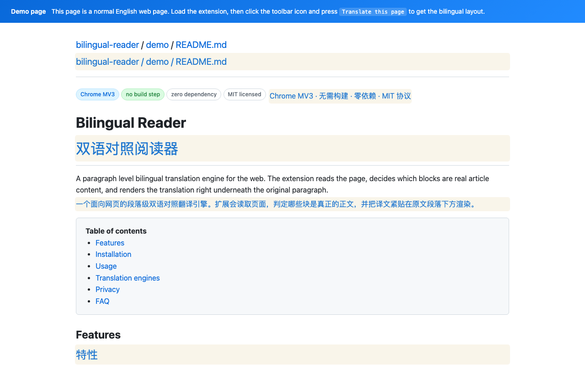
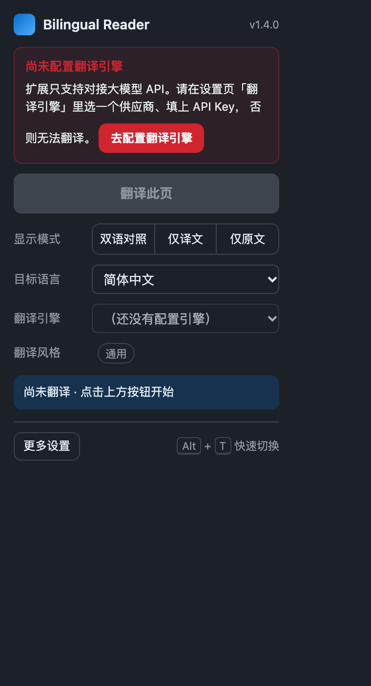
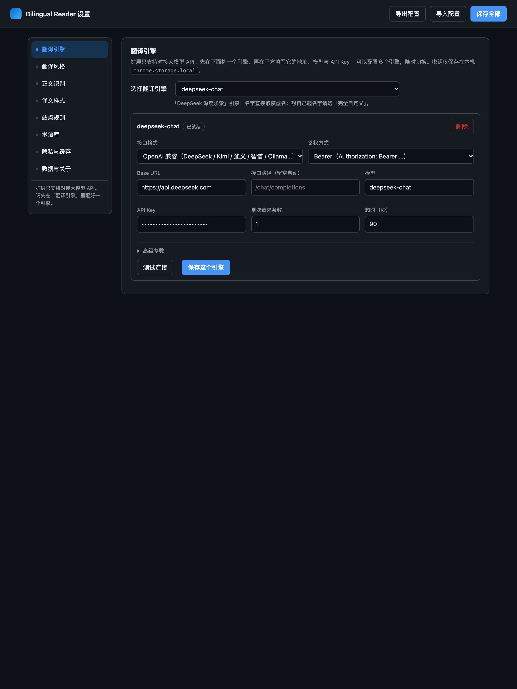

# Bilingual Reader

[English](README.md) | [简体中文](README.zh-CN.md) | **日本語** | [한국어](README.ko.md) | [Español](README.es.md)

**Web ページの原文と訳文を、段落ごとに並べて読む。**

Bilingual Reader は、Web ページの本文を識別し、各段落のそばに訳文を表示する Chrome 拡張機能です。見出し、リスト、表のセルも翻訳でき、コードブロックは原文のまま残します。ご自身のモデル API またはローカルで動作するモデルを利用します。

ビルド、npm のインストール、サードパーティーのランタイムは不要です。拡張機能の画面は現在、主に簡体字中国語です。この README の各言語版は、同じ拡張機能について説明しています。

[Web サイト](https://xuyang1996.github.io/bilingual-reader/ja/) · [ダウンロード](https://github.com/xuyang1996/bilingual-reader/releases) · [プライバシーポリシー](https://xuyang1996.github.io/bilingual-reader/privacy.html) · [問題の報告](https://github.com/xuyang1996/bilingual-reader/issues)

## 表示例



| ツールバーのパネル | 設定画面 |
| --- | --- |
|  |  |

## 主な機能

- **対訳での閲覧**：原文と訳文、訳文のみ、原文のみを切り替え、読み終わったらページを復元できます。
- **英語学習**。英文の骨格や表現、単語の文脈に合った意味、米国英語の発音記号と語の成り立ちを確認できます。端末の音声で読み上げ、単語や文を保存して復習できます。[学習用の例文](https://xuyang1996.github.io/bilingual-reader/demo.html#study)
- **本文の識別**：ナビゲーション、サイドバー、フッターなどを標準で除外します。サイトルールで範囲を調整できます。
- **遅延翻訳**：ページ全体を一度に送信せず、表示領域の近くにある段落を優先します。
- **動的コンテンツ**：増分翻訳を有効にすると、新しく挿入された内容も翻訳します。
- **モデルを自由に設定**：複数のプロバイダー、独自ゲートウェイ、ローカルサーバーを登録できます。
- **翻訳スタイル**：14 種類の組み込みシナリオ、編集可能なプロンプト、URL による自動選択に対応します。
- **用語とプライバシー**：用語集の指示、訳文の後処理、任意の機密情報マスキングを利用できます。
- **ローカル保存**：設定と翻訳キャッシュをブラウザー内に保存し、JSON 形式で設定を入出力できます。

## はじめに

1. [Releases](https://github.com/xuyang1996/bilingual-reader/releases) から **`bilingual-reader.zip`** をダウンロードして展開するか、このリポジトリをクローンします。
2. `chrome://extensions` を開き、**デベロッパー モード**を有効にします。
3. **パッケージ化されていない拡張機能を読み込む**を選び、`manifest.json` があるディレクトリを指定します。展開した `bilingual-reader` ディレクトリ、またはリポジトリのルートです。
4. 拡張機能の設定を開き、**翻訳エンジン（`翻译引擎`）**でプロバイダーを選び、API URL、モデル、API キーを入力します。**接続テスト（`测试连接`）**の後、**このエンジンを保存（`保存这个引擎`）**をクリックします。
5. 通常の Web ページを開き、拡張機能のアイコン → **このページを翻訳（`翻译此页`）**を選びます。
6. パネルで翻訳先の言語を選びます。初期値は簡体字中国語で、17 の翻訳先言語が用意されています。

メインボタンの下にある**一時停止（`暂停`）**は、訳文を残して実行中・待機中の処理をキャンセルし、**再開（`继续`）**に切り替わります。再開すると停止位置の一つ前の段落から翻訳します。**再翻訳（`重新翻译`）**は、このページの訳文を消し、古いキャッシュを使わず最初の段落からやり直します。**復元（`还原本页`）**は訳文を削除して翻訳を終了します。

新規インストール時には、**エンジンは未設定**です。実際の翻訳には利用可能なモデルの接続先が必要です。拡張機能自体は翻訳サーバーや API 利用枠を提供しません。プロバイダーによってはリクエストに料金がかかります。

通常の Web ページの右側に固定された **`译` フローティングボタン**からも翻訳できます。大きさは 32 px で、通常は半透明、ホバー時は不透明になります。上下にドラッグでき、高さはページ間で保存されます。ホバーまたはキーボードでフォーカスすると、一時停止・再開、再翻訳、復元、設定、非表示の操作ができます。非表示にした後は、拡張機能パネルの **显示网页浮签**、または設定の **译文样式** から再表示できます。

### API キーなしで試す

設定で**デモモード（`演示模式（本地示例，无需 Key）`）**を追加して保存し、[英語のデモページ](https://xuyang1996.github.io/bilingual-reader/demo.html)を開いて翻訳を開始します。

デモモードは同梱の辞書をローカルで使用し、通信しません。訳文には薄い黄色の背景が付きます。本文識別、レイアウト、表示切り替え、復元を体験するためのものであり、**機械翻訳ではありません**。

### ショートカットと右クリックメニュー

| 操作 | 初期ショートカット |
| --- | --- |
| 現在のページを翻訳 / 復元 | `Alt+T` |
| 翻訳を開始 | `Alt+Shift+T` |
| ページを復元 | `Alt+Shift+R` |

`chrome://extensions/shortcuts` で変更できます。ページの右クリックメニューにも、翻訳、復元、訳文のみ、原文のみの操作があります。

## モデル API の設定

OpenAI、Anthropic Claude、Google Gemini、DeepSeek、Kimi、Qwen、GLM、OpenRouter などのプリセットがあります。ローカル向けには Ollama、vLLM、LM Studio を用意しています。

| インターフェース | 設定内容 |
| --- | --- |
| OpenAI 互換 | Base URL、任意のパス、モデル、認証 |
| Anthropic Messages | Anthropic のリクエスト形式と認証 |
| Gemini generateContent | Gemini のリクエスト形式、モデルのパス、キー設定 |
| カスタム / ゲートウェイ | パス、ヘッダー、追加のリクエスト本文、応答フィールドのパス |
| ローカルモデル | ローカルサーバーの URL とモデル。キー不要の認証は、サーバーが許可する場合のみ使用 |

プリセットの推奨値は入力のヒントです。利用するサービスで必要な値を入力してください。プリセットのエンジン名はモデル名に従います。独自の名前を付ける場合や、同じモデルを複数のゲートウェイで使う場合は、**完全カスタム（`完全自定义`）**を選び、重複しない名前を設定してください。

エンジン層は URL 候補（`/v1` の不足など）、認証のフォールバック、複数の応答形式、SSE を処理し、成功した URL と認証の組み合わせを記憶します。番号付きバッチ応答を正しく対応付けられない場合は、個別リクエストに戻ります。一部の推論モデルではモデル名に応じてパラメーターを調整しますが、実際の互換性はサービスに依存します。

詳細設定では、認証方式、system/developer/user ロール、タイムアウト、バッチ件数、temperature、出力トークン上限、ヘッダー、追加の JSON 本文、応答パス、システムプロンプトを指定できます。[ローカル API テストページ](test/engine.html)でリクエストと応答を確認できます。拡張機能の外で実行すると、ブラウザーの CORS 制限を受ける場合があります。

翻訳に失敗すると、ポップアップに API エラーを表示します。設定でモデル、認証、利用枠を確認し、**重试失败段落**（失敗した段落を再試行）を押してください。成功した訳文は保持されます。一時的な通信・API エラーは最大 2 回再試行し、モデル・接続先・継続的なサービス障害では後続のリクエストを一時停止します。[障害対応の説明](docs/RELIABILITY.zh-CN.md)（中国語）も参照してください。

## 翻訳スタイル

| シナリオ | 重視する内容 |
| --- | --- |
| 汎用 | 忠実で簡潔な翻訳 |
| 技術 / ソフトウェア | 専門用語と製品名 |
| ニュース / メディア | 事実、引用、発言の帰属 |
| 学術論文 | 数式、引用、主張の強さ |
| プログラミング文書 | API、コマンド、識別子 |
| GitHub | Issue、Pull Request、Markdown、コード |
| 法律 | 定義された用語と法的参照 |
| 医療 / 健康 | 医学用語、数量、単位 |
| 金融 | 数値、割合、金融用語 |
| EC / ショッピング | ブランド、仕様、購入条件 |
| カスタマーサポート | 語調と責任を保ち、約束を追加しない |
| 小説 | 語り口、リズム、物語の文体 |
| ソーシャルメディア | 口語、メンション、ハッシュタグ |
| やさしい英語 | 難しい英語を、より簡単な英語に書き換える |

URL による自動選択は初期状態で有効です。一致するシナリオがあれば手動選択より優先されます。組み込みプロンプトを編集したり、独自のシナリオを追加したりできます。`{target}` は翻訳先言語の名前に置き換えられます。

エンジン独自のシステムプロンプトを指定すると、シナリオと汎用ルールを上書きします。未指定の場合は汎用ルールにシナリオの指示を追加します。その後、使用時のバッチ規約と用語集の指示を追加します。

## サイトルールと用語集

**サイトルール（`站点规则`）**に JSON 配列を入力すると、本文セレクター、除外要素、言語、表示モード、識別しきい値を設定できます。URL ワイルドカード、`||example.com` によるドメイン一致、`parentId` による継承に対応し、より具体的な一致ルールが後から適用されます。

```json
[
  {
    "id": "docs-site",
    "name": "Documentation",
    "urlPattern": ["*docs.example.com*"],
    "translationMode": "dual",
    "targetLang": "zh-Hans",
    "mainSelector": "main",
    "excludeSelectors": [".sidebar", "nav", ".advertisement"],
    "thresholds": { "paragraphMinTextCount": 2 }
  }
]
```

標準の最小段落長は 2 文字、ページ本文のしきい値は 50 文字です。**ページ全体の翻訳（`整页翻译`）**では、通常除外するナビゲーションなども対象になります。インラインの技術的な断片はプレースホルダーで保護し、独立したコードブロックは除外します。

用語集には、原語と訳語をタブまたはカンマで区切り、1 行に 1 組記入します。例えば次のように指定できます。

```text
large language model,大規模言語モデル
pull request,プルリクエスト
```

用語はモデルのプロンプトに追加されます。後処理でも残っている原語を置換しますが、別の訳語がすでに使われている場合まで、すべて修正できるわけではありません。

## プライバシーと保存

- 開発者は、本文、API キー、利用統計を受信するサーバーを運営していません。広告・テレメトリー SDK もありません。
- 実際の翻訳では、処理後の本文、プロンプト、認証情報を**設定した接続先へ直接送信**します。その運営者のポリシーが適用されます。信頼できる接続先を選び、リモートサービスには HTTPS を使用してください。
- 任意のマスキングは、メールアドレス、電話番号、カード番号、身分証番号、IP アドレス、URL、IBAN を対象とします。パターン認識のため、**すべての機密情報の除去は保証しません**。
- 設定、API キー、翻訳キャッシュは `chrome.storage.local` に保存します。キャッシュキーには本文、言語、エンジンの識別情報が含まれ、30 日経過した項目は読み取り時に無効になります。無効化や削除も可能です。
- JSON 設定のエクスポートには API キーが含まれます。バックアップは非公開で保管してください。キャッシュと設定は、それぞれの設定項目から削除できます。アンインストールでもローカル保存データを削除できます。
- ローカル処理だけにしたい場合は、デモモードか、実際にご自身のコンピューター上で動くモデルサービスを使ってください。「ローカル」プリセットの選択だけでは、任意の URL の送信先は決まりません。

詳細は[プライバシーポリシー](https://xuyang1996.github.io/bilingual-reader/privacy.html)をご覧ください。

## アーキテクチャと開発

Manifest V3、classic JavaScript スクリプト、共有の `IMT` 名前空間を使用します。コアモジュールは `chrome.*` に依存せず、翻訳の通信処理を拡張機能用・テスト用に注入できます。

| パス | 役割 |
| --- | --- |
| `src/shared/` | 初期設定、プロバイダー、ユーティリティ、設定移行、プロンプト |
| `src/core/` | ルール、分割、スケジューリング、マスキング、用語、描画 |
| `src/content/` | ページの操作とバックグラウンドへの接続 |
| `src/background/` | API アダプター、キャッシュ、メッセージ、ショートカット、メニュー |
| `src/popup/`, `src/options/` | ツールバーのパネルと設定画面 |
| `test/` | DOM テスト、模擬モデルサーバー、ブラウザー検証スクリプト |
| `docs/` | 文書、スクリーンショット、GitHub Pages 用ファイル |

処理の流れは、**ルール解決 → 段落収集 → スケジューリング → マスキング → キャッシュ/API → プレースホルダー復元 → 用語適用 → 描画**です。ページの復元では原文ノードのラッパーを外し、挿入した訳文を削除します。表示モードは CSS クラスで制御します。

編集後は拡張機能を再読み込みし、対象ページも更新してください。大きな変更の前に、[開発ガイド](docs/DEVELOPMENT.md)、[製品要件](docs/PRD.md)、[元の詳細技術ノート](docs/README-technical.zh-CN.md)を参照してください。これらの詳細文書は現在、中国語です。

### ローカルでの検証

`bilingual-reader` という名前のディレクトリにチェックアウトし、静的サーバーを起動して DOM テストページを開きます。ブラウザー検証スクリプトは、別のターミナルでリポジトリのルートから実行してください。

```bash
git clone https://github.com/xuyang1996/bilingual-reader.git
cd bilingual-reader
python3 -m http.server 8766 --bind 127.0.0.1 --directory ..
```

`http://127.0.0.1:8766/bilingual-reader/test/harness.html?autotest=1`

```bash
python3 test/e2e.py --ext . \
  --url http://127.0.0.1:8766/bilingual-reader/demo/demo.html \
  --out /tmp/bilingual-reader-e2e.png
python3 test/verify_ai.py --ext .
python3 test/verify_reliability.py --ext .
python3 test/verify_floating.py --ext .
python3 test/verify_options.py --ext .
python3 test/verify_popup.py --ext . \
  --url http://127.0.0.1:8766/bilingual-reader/demo/demo.html
```

ブラウザーテストは**順番に実行**してください。Python 標準ライブラリーを使用し、Chrome の初期パスは macOS のものです。ほかの環境では `--chrome /path/to/chrome` を指定します。API 形式のテストはローカルの模擬 HTTP サービスを使い、有料プロバイダーには接続しません。

2026-11-04 の検証記録：**DOM テスト 67 件、API 形式の検証 35 件、設定の検証 53 件が成功。パネルの動作検証も成功し、配布パッケージはデモの 52 段落をエラー 0 件で翻訳しました。** 過去の検証結果であり、各プロバイダーの現在の稼働状況を保証するものではありません。

Chrome ウェブストア用 ZIP の作成：

```bash
python3 test/build_store_zip.py --ext . --out ../bilingual-reader-store.zip
```

ストア用 ZIP はルートに `manifest.json` を置き、テスト、文書、ストア画像を除外します。ソースアーカイブには `bilingual-reader/` 以下にプロジェクト全体が含まれます。

## 制限と貢献

- 本リリースは Chrome / Chromium の Manifest V3 向けです（マニフェストの最小バージョンは Chrome 96）。Firefox と Safari には対応していません。
- Chrome の内部ページと Chrome ウェブストアのページは翻訳できません。closed shadow root にもアクセスできません。
- React/Vue の頻繁な再描画で訳文が消えることがあります。本文識別はヒューリスティックに基づくため、特殊なサイトでは独自ルールが必要になる場合があります。
- API のレート制限、利用枠、認証、稼働状況はプロバイダーによって異なります。すべての API がすべての詳細設定に対応するわけではありません。
- モデル、接続先、プロンプト、用語集を変更すると、別の翻訳キャッシュを自動的に使用します。

[Issues](https://github.com/xuyang1996/bilingual-reader/issues) や Pull Request での報告・貢献を歓迎します。可能であれば、Chrome のバージョン、再現手順、公開のサンプル URL を記載してください。API キーや非公開の本文は含めないでください。

## 着想と謝辞

本プロジェクトの着想は **[Immersive Translate（沉浸式翻译）](https://immersivetranslate.com/)** から得ています。翻訳スタイルには、公開リポジトリ **[immersive-translate/prompts](https://github.com/immersive-translate/prompts)** のシナリオプロンプトを、本プロジェクトに合わせて調整して使用しています。Immersive Translate チームとプロンプトの貢献者に感謝します。

## ライセンス

プロジェクトの MIT ライセンスと出典に関する記載は [LICENSE](LICENSE) を参照してください。
