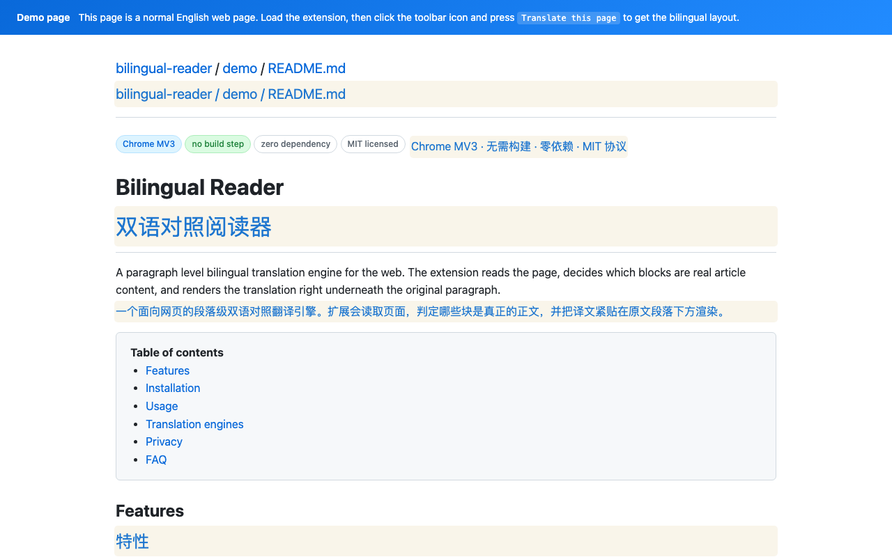
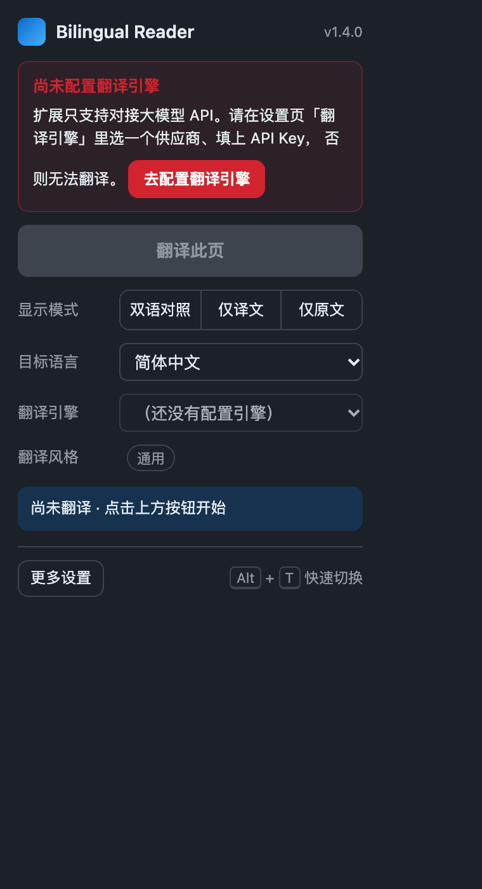
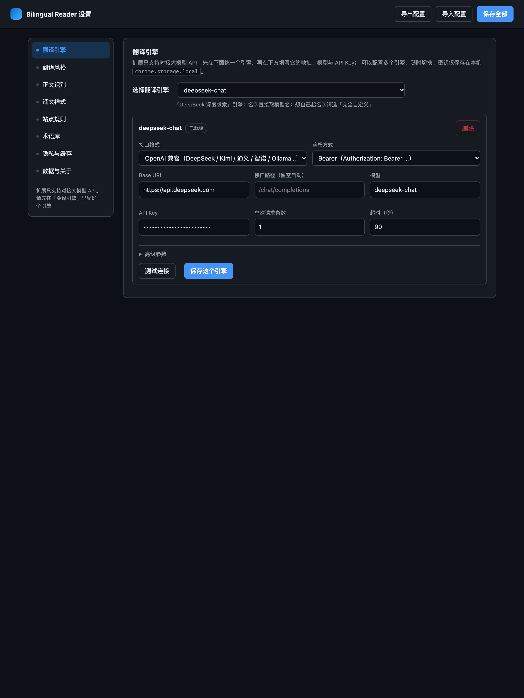

# Bilingual Reader

[English](README.md) | [简体中文](README.zh-CN.md) | [日本語](README.ja.md) | **한국어** | [Español](README.es.md)

**웹페이지의 원문과 번역문을 문단별로 나란히 읽으세요.**

Bilingual Reader는 웹페이지 본문을 식별하고 각 문단 옆에 번역문을 표시하는 Chrome 확장 프로그램입니다. 제목, 목록, 표의 셀을 번역하며 코드 블록은 원문으로 유지합니다. 사용자가 설정한 모델 API 또는 로컬 모델을 이용합니다.

빌드, npm 설치, 별도의 서드파티 런타임이 필요하지 않습니다. 확장 프로그램 화면은 현재 주로 중국어 간체로 제공됩니다. 여러 언어의 README는 동일한 확장 프로그램을 설명합니다.

[웹사이트](https://xuyang1996.github.io/bilingual-reader/ko/) · [다운로드](https://github.com/xuyang1996/bilingual-reader/releases) · [개인정보 처리방침](https://xuyang1996.github.io/bilingual-reader/privacy.html) · [문제 신고](https://github.com/xuyang1996/bilingual-reader/issues)

## 미리 보기



| 도구 모음 패널 | 설정 화면 |
| --- | --- |
|  |  |

## 주요 기능

- **대조 읽기**: 원문과 번역문, 번역문만, 원문만 표시하는 모드를 전환하고 페이지를 복원합니다.
- **본문 식별**: 기본적으로 탐색 메뉴, 사이드바, 바닥글 등을 제외합니다. 사이트 규칙으로 범위를 조정할 수 있습니다.
- **지연 번역**: 페이지 전체를 한꺼번에 보내지 않고 화면에 가까운 문단을 우선 요청합니다.
- **동적 콘텐츠**: 증분 번역을 켜면 새로 추가된 내용도 번역합니다.
- **직접 설정하는 모델**: 여러 제공업체, 자체 게이트웨이, 로컬 서버를 등록할 수 있습니다.
- **번역 스타일**: 내장 시나리오 14개, 프롬프트 편집, URL에 따른 자동 선택을 지원합니다.
- **용어와 개인정보**: 용어집 지침, 번역 후처리, 선택적인 민감 정보 마스킹을 제공합니다.
- **로컬 설정과 캐시**: 설정과 번역 캐시를 브라우저에 저장하며 JSON 가져오기·내보내기를 지원합니다.

## 빠른 시작

1. [Releases](https://github.com/xuyang1996/bilingual-reader/releases)에서 **`bilingual-reader.zip`**을 내려받아 압축을 풀거나 저장소를 복제합니다.
2. `chrome://extensions`를 열고 **개발자 모드**를 켭니다.
3. **압축해제된 확장 프로그램을 로드합니다**를 선택하고 `manifest.json`이 있는 디렉터리를 지정합니다. 압축을 푼 `bilingual-reader` 폴더 또는 저장소 루트입니다.
4. 확장 프로그램 설정의 **번역 엔진(`翻译引擎`)**에서 제공업체를 선택하고 API URL, 모델, API 키를 입력합니다. **연결 테스트(`测试连接`)** 후 **이 엔진 저장(`保存这个引擎`)**을 누릅니다.
5. 일반 웹페이지에서 확장 프로그램 아이콘 → **이 페이지 번역(`翻译此页`)**을 선택합니다.
6. 패널에서 대상 언어를 선택합니다. 기본 대상은 중국어 간체이며, 대상 언어 17개가 제공됩니다.

새로 설치하면 **설정된 엔진이 없습니다**. 실제 번역에는 사용 가능한 모델 엔드포인트가 필요합니다. 이 확장 프로그램은 자체 번역 서버나 API 사용 크레딧을 제공하지 않으며, 제공업체가 요청에 요금을 부과할 수 있습니다.

### API 키 없이 체험하기

설정에서 **데모 모드(`演示模式（本地示例，无需 Key）`)**를 추가하고 저장한 다음, [영문 데모 페이지](https://xuyang1996.github.io/bilingual-reader/demo.html)를 열어 번역을 시작합니다.

데모 모드는 내장 사전을 로컬에서 사용하며 네트워크 요청을 보내지 않습니다. 번역문에 연한 노란색 배경이 표시됩니다. 본문 식별, 레이아웃, 표시 모드, 복원 과정을 체험하는 기능이며 **실제 기계 번역이 아닙니다**.

### 단축키와 우클릭 메뉴

| 동작 | 기본 단축키 |
| --- | --- |
| 현재 페이지 번역 / 복원 | `Alt+T` |
| 번역 시작 | `Alt+Shift+T` |
| 페이지 복원 | `Alt+Shift+R` |

`chrome://extensions/shortcuts`에서 변경할 수 있습니다. 페이지 우클릭 메뉴에도 번역, 복원, 번역문만, 원문만 표시하는 기능이 있습니다.

## 모델 API 연결

OpenAI, Anthropic Claude, Google Gemini, DeepSeek, Kimi, Qwen, GLM, OpenRouter 등의 프리셋을 제공합니다. 로컬 프리셋에는 Ollama, vLLM, LM Studio가 포함됩니다.

| 인터페이스 | 설정 |
| --- | --- |
| OpenAI 호환 | Base URL, 선택적 경로, 모델, 인증 |
| Anthropic Messages | Anthropic 요청 형식과 인증 |
| Gemini generateContent | Gemini 요청 형식, 모델 경로, 키 설정 |
| 사용자 지정 / 게이트웨이 | 경로, 헤더, 추가 요청 본문, 응답 필드 경로 |
| 로컬 모델 | 로컬 서버 URL과 모델. 서버가 허용하는 경우에만 키 없는 인증 사용 |

프리셋 권장값은 입력 힌트입니다. 실제 서비스에서 요구하는 값을 입력하세요. 프리셋 엔진 이름은 모델 이름을 따릅니다. 직접 이름을 지정하거나 같은 모델을 여러 게이트웨이에서 사용하려면 **완전 사용자 지정(`完全自定义`)**을 선택하고 고유한 이름을 설정하세요.

엔진 계층은 URL 후보(`/v1` 누락 등), 인증 대체 시도, 다양한 응답 형식, SSE를 처리하며 성공한 URL·인증 조합을 기억합니다. 번호가 붙은 일괄 응답을 맞출 수 없으면 개별 요청으로 전환합니다. 일부 추론 모델은 모델 이름에 따라 매개변수를 조정하지만, 실제 호환성은 서비스에 따라 달라집니다.

고급 설정에는 인증 방식, system/developer/user 역할, 시간 제한, 일괄 처리 수, temperature, 출력 토큰 한도, 사용자 지정 헤더, 추가 JSON 본문, 응답 경로, 시스템 프롬프트가 있습니다. [로컬 API 테스트 페이지](test/engine.html)에서 요청과 응답을 확인할 수 있습니다. 확장 프로그램 밖에서는 브라우저 CORS 제한이 적용될 수 있습니다.

## 번역 스타일

| 시나리오 | 중점 사항 |
| --- | --- |
| 일반 | 충실하고 간결한 번역 |
| 기술 / 소프트웨어 | 기술 용어와 제품명 |
| 뉴스 / 미디어 | 사실, 인용, 발언 주체 |
| 학술 논문 | 수식, 인용, 주장의 강도 |
| 프로그래밍 문서 | API, 명령어, 식별자 |
| GitHub | Issue, Pull Request, Markdown, 코드 |
| 법률 | 정의된 용어와 법적 참조 |
| 의료 / 건강 | 의학 용어, 수량, 단위 |
| 금융 | 수치, 백분율, 금융 용어 |
| 전자상거래 | 브랜드, 사양, 구매 조건 |
| 고객 지원 | 어조와 책임을 유지하고 약속을 추가하지 않음 |
| 소설 | 말투, 리듬, 서술 방식 |
| 소셜 미디어 | 구어체, 멘션, 해시태그 |
| 쉬운 영어 | 어려운 영어를 더 쉬운 영어로 바꾸기 |

URL 자동 선택은 기본적으로 켜져 있으며, 일치하는 시나리오가 수동 선택보다 우선합니다. 내장 프롬프트를 수정하거나 사용자 시나리오를 추가할 수 있습니다. `{target}`은 대상 언어 이름으로 바뀝니다.

엔진의 사용자 지정 시스템 프롬프트는 시나리오와 일반 규칙을 덮어씁니다. 지정하지 않으면 일반 규칙 뒤에 시나리오 지침을 추가합니다. 이후 필요할 때 일괄 처리 규약을 추가하고 용어집 지침을 마지막에 붙입니다.

## 사이트 규칙과 용어집

**사이트 규칙(`站点规则`)**에 JSON 배열을 입력하면 본문 선택자, 제외할 요소, 언어, 표시 모드, 식별 기준값을 지정할 수 있습니다. URL 와일드카드, `||example.com` 도메인 일치, `parentId` 상속을 지원하며 더 구체적인 일치 규칙을 나중에 적용합니다.

```json
[
  {
    "id": "docs-site",
    "name": "Documentation",
    "urlPattern": ["*docs.example.com*"],
    "translationMode": "dual",
    "targetLang": "zh-Hans",
    "mainSelector": "main",
    "excludeSelectors": [".sidebar", "nav", ".advertisement"],
    "thresholds": { "paragraphMinTextCount": 2 }
  }
]
```

기본 최소 문단 길이는 2자, 페이지 본문 기준은 50자입니다. **전체 페이지 번역(`整页翻译`)**은 평소 제외하는 탐색 메뉴 등의 영역도 포함합니다. 인라인 기술 구문은 플레이스홀더로 보호하고 독립된 코드 블록은 건너뜁니다.

용어집에는 원문과 번역어를 탭이나 쉼표로 구분해 한 줄에 한 쌍씩 입력합니다. 예:

```text
large language model,대규모 언어 모델
pull request,풀 리퀘스트
```

용어는 모델 프롬프트에 추가됩니다. 후처리에서도 남아 있는 원문 용어를 바꾸지만, 이미 다른 번역어로 옮겨진 결과까지 모두 교정하는 것은 아닙니다.

## 개인정보와 저장

- 개발자는 페이지 본문, API 키, 사용 통계를 수신하는 서버를 운영하지 않습니다. 광고·원격 측정 SDK도 없습니다.
- 실제 번역은 처리된 본문, 프롬프트, 인증 정보를 **사용자가 설정한 엔드포인트로 직접 전송**합니다. 해당 운영자의 정책이 적용됩니다. 신뢰할 수 있는 엔드포인트를 선택하고 원격 서비스에는 HTTPS를 사용하세요.
- 선택적 마스킹 대상은 이메일, 전화번호, 카드 번호, 신분증 번호, IP 주소, URL, IBAN입니다. 패턴 기반이므로 **모든 민감 정보 제거를 보장하지 않습니다**.
- 설정, API 키, 번역 캐시는 `chrome.storage.local`에 저장됩니다. 캐시 키에는 텍스트·언어·엔진 식별 정보가 포함되며 30일이 지난 항목은 읽을 때 만료됩니다. 캐시를 끄거나 지울 수 있습니다.
- 내보낸 JSON 설정에는 API 키가 포함됩니다. 백업을 비공개로 보관하세요. 캐시와 설정은 각각의 설정 메뉴에서 삭제하거나, 확장 프로그램을 제거해 로컬 저장소를 삭제할 수 있습니다.
- 로컬 처리만 필요하면 데모 모드 또는 실제로 자신의 컴퓨터에서 실행 중인 모델 서비스를 사용하세요. “로컬” 프리셋을 고르는 것만으로 사용자 지정 URL의 전송 대상이 정해지지는 않습니다.

자세한 내용은 [개인정보 처리방침](https://xuyang1996.github.io/bilingual-reader/privacy.html)을 참조하세요.

## 구조와 개발

Manifest V3, classic JavaScript 스크립트, 공유 `IMT` 네임스페이스를 사용합니다. 핵심 모듈은 `chrome.*`에 의존하지 않으며, 확장 프로그램이나 테스트에 맞게 번역 전송 계층을 주입할 수 있습니다.

| 경로 | 역할 |
| --- | --- |
| `src/shared/` | 기본값, 제공업체, 유틸리티, 설정 이전, 프롬프트 |
| `src/core/` | 규칙, 문단 분할, 예약 처리, 마스킹, 용어, 렌더링 |
| `src/content/` | 페이지 명령과 백그라운드 연결 |
| `src/background/` | API 어댑터, 캐시, 메시지, 단축키, 메뉴 |
| `src/popup/`, `src/options/` | 도구 모음 패널과 설정 화면 |
| `test/` | DOM 테스트, 모의 모델 서버, 브라우저 검증 스크립트 |
| `docs/` | 문서, 스크린샷, GitHub Pages 리소스 |

흐름은 **규칙 해석 → 문단 수집 → 예약 처리 → 마스킹 → 캐시/API → 플레이스홀더 복원 → 용어 적용 → 렌더링**입니다. 복원 시 원문 래퍼를 풀고 삽입한 번역문을 제거합니다. 표시 모드는 CSS 클래스로 제어합니다.

수정 후 확장 프로그램을 다시 로드하고 대상 웹페이지를 새로고침하세요. 큰 변경 전에는 [개발 가이드](docs/DEVELOPMENT.md), [제품 요구사항](docs/PRD.md), [기존 상세 기술 설명](docs/README-technical.zh-CN.md)을 읽어보세요. 이 상세 문서들은 현재 중국어로 제공됩니다.

### 로컬 검증

체크아웃 디렉터리 이름이 `bilingual-reader`라면 정적 서버를 시작하고 DOM 테스트 페이지를 엽니다. 브라우저 스크립트는 두 번째 터미널에서 저장소 루트를 기준으로 실행하세요.

```bash
git clone https://github.com/xuyang1996/bilingual-reader.git
cd bilingual-reader
python3 -m http.server 8766 --bind 127.0.0.1 --directory ..
```

`http://127.0.0.1:8766/bilingual-reader/test/harness.html?autotest=1`

```bash
python3 test/e2e.py --ext . \
  --url http://127.0.0.1:8766/bilingual-reader/demo/demo.html \
  --out /tmp/bilingual-reader-e2e.png
python3 test/verify_ai.py --ext .
python3 test/verify_options.py --ext .
python3 test/verify_popup.py --ext . \
  --url http://127.0.0.1:8766/bilingual-reader/demo/demo.html
```

브라우저 테스트는 **순서대로 실행**하세요. 스크립트는 Python 표준 라이브러리를 사용하며 Chrome 기본 경로는 macOS 설치 위치입니다. 다른 환경에서는 `--chrome /path/to/chrome`을 지정하세요. API 형식 테스트는 유료 제공업체 대신 로컬 모의 HTTP 서비스를 사용합니다.

2026-11-04 검증 기록: **DOM 테스트 67개, API 형식 검증 35개, 설정 검증 53개가 통과했습니다. 패널 동작 검증도 통과했으며 배포 패키지는 데모 문단 52개를 오류 0개로 번역했습니다.** 이는 기록된 결과이며 모든 제공업체의 현재 가용성을 보장하지 않습니다.

Chrome 웹 스토어용 압축 파일 만들기:

```bash
python3 test/build_store_zip.py --ext . --out ../bilingual-reader-store.zip
```

스토어 ZIP은 루트에 `manifest.json`을 배치하고 테스트, 문서, 스토어 이미지를 제외합니다. 소스 압축 파일에는 `bilingual-reader/` 아래에 전체 프로젝트가 포함됩니다.

## 제한과 기여

- 이 버전은 Chrome / Chromium의 Manifest V3를 대상으로 합니다(매니페스트 최소 버전: Chrome 96). Firefox와 Safari는 지원하지 않습니다.
- Chrome 내부 페이지와 Chrome 웹 스토어 페이지는 번역할 수 없으며 closed shadow root에는 접근할 수 없습니다.
- React/Vue가 자주 다시 렌더링하면 번역문이 덮어써질 수 있습니다. 본문 식별은 휴리스틱 방식이므로 특수한 사이트에는 사용자 규칙이 필요할 수 있습니다.
- API 속도 제한, 사용량, 인증, 가용성은 제공업체에 따라 다릅니다. 모든 API가 모든 고급 설정을 지원하는 것은 아닙니다.
- 같은 엔진 ID에서 모델이나 프롬프트를 바꾸면 이전 캐시가 재사용될 수 있습니다. 결과를 비교할 때 캐시를 지우세요.

[Issues](https://github.com/xuyang1996/bilingual-reader/issues)와 Pull Request를 통한 제보와 기여를 환영합니다. 가능하면 Chrome 버전, 재현 단계, 공개 예제 URL을 포함하세요. API 키나 비공개 페이지 내용은 포함하지 마세요.

## 영감과 감사

이 프로젝트는 **[Immersive Translate(沉浸式翻译)](https://immersivetranslate.com/)**에서 영감을 받았습니다. 번역 스타일에는 공개 저장소 **[immersive-translate/prompts](https://github.com/immersive-translate/prompts)**의 시나리오 프롬프트를 이 프로젝트에 맞게 조정해 사용했습니다. Immersive Translate 팀과 프롬프트 기여자들에게 감사드립니다.

## 라이선스

프로젝트의 MIT 라이선스와 출처 표기는 [LICENSE](LICENSE)를 참조하세요.
