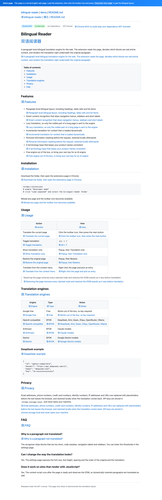
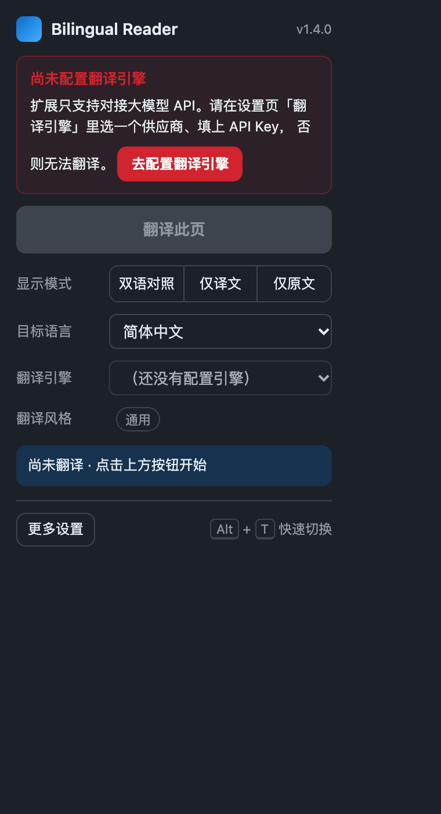
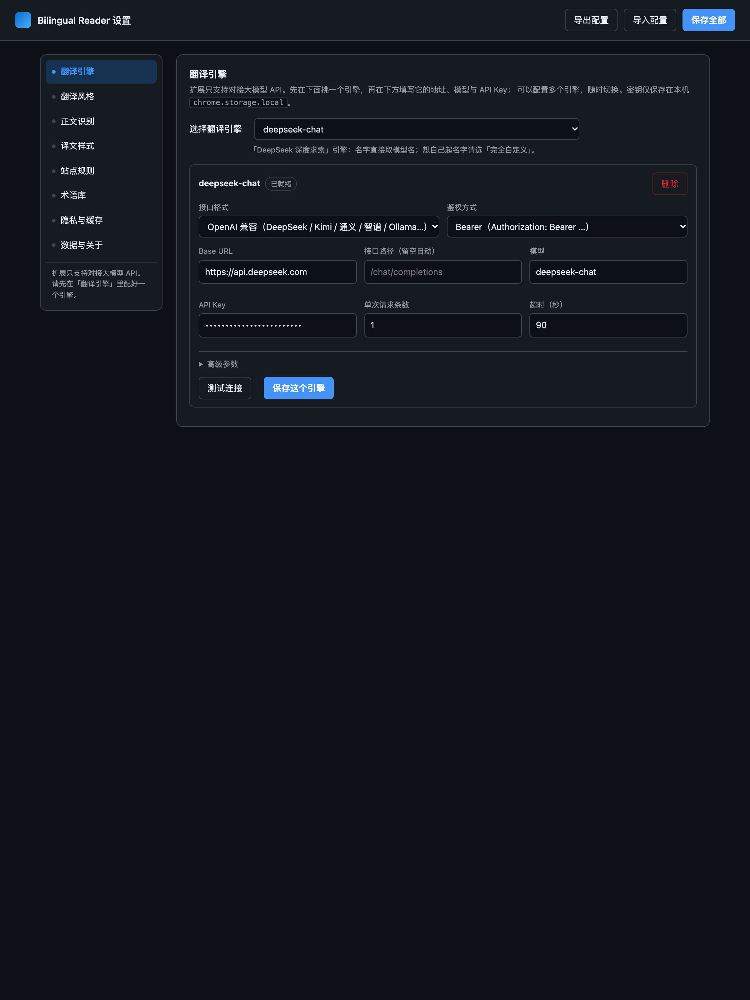
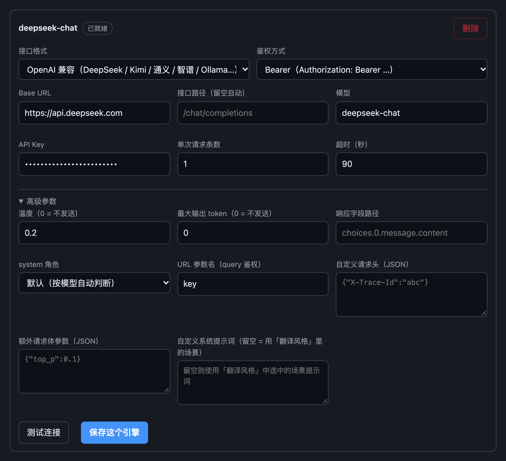
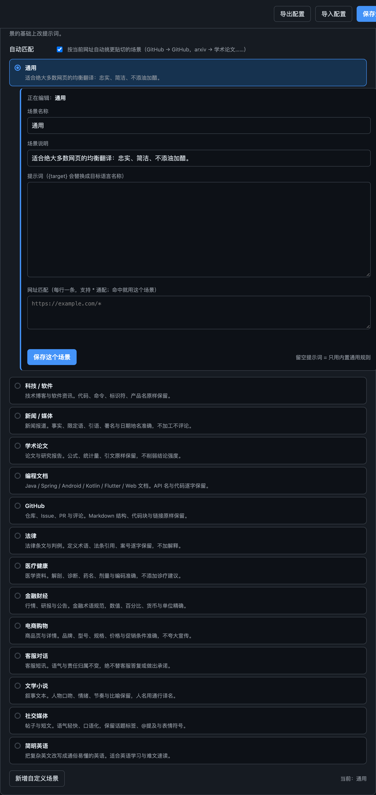
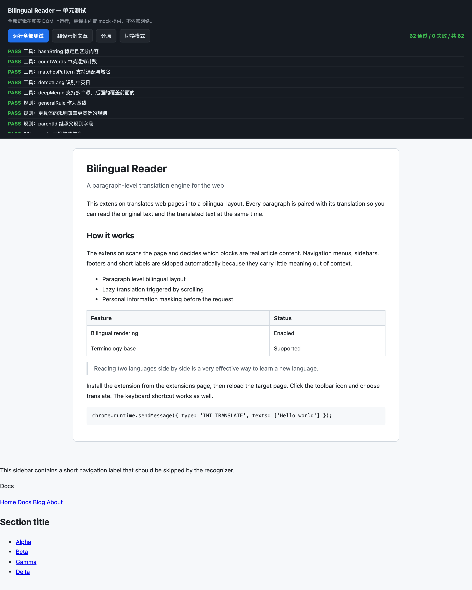
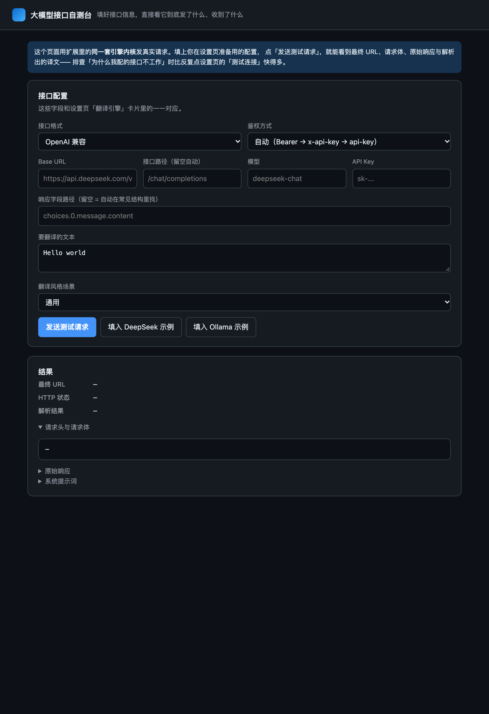

# Bilingual Reader · 双语对照翻译

一个可直接在 Chrome 中使用的**段落级双语对照翻译扩展**。它把网页正文逐段翻译，原文在上、译文在下对齐显示——标题、副标题、表格单元格、列表项都在内。

零构建：解压后直接「加载已解压的扩展程序」即可运行，不需要 npm install，不需要打包工具，不依赖任何第三方运行时。

> 本项目是依据公开技术拆解独立实现的产品，与「沉浸式翻译」无代码、无品牌关联。

项目主页：[GitHub Pages](https://xuyang1996.github.io/bilingual-reader/) · [隐私政策](https://xuyang1996.github.io/bilingual-reader/privacy.html) · [下载发布包](https://github.com/xuyang1996/bilingual-reader/releases) · [反馈问题](https://github.com/xuyang1996/bilingual-reader/issues)

### 配套文档

| 文档 | 写给谁 | 回答什么 |
| --- | --- | --- |
| [`docs/PRD.md`](docs/PRD.md) | 产品 / 需求方 | **做什么、给谁用、验收标准**。9 条功能需求 FR-1~FR-9、数据模型、消息协议、已知限制 |
| [`docs/DEVELOPMENT.md`](docs/DEVELOPMENT.md) | **下一个接手代码的开发者** | **怎么做的、为什么这么设计、代码该往哪儿写、哪些坑不能踩**。架构、核心机制拆解、代码地图、扩展点、测试体系、陷阱清单、调试手册 |

> 想改代码，**先读开发文档**，再动源码；想了解产品全貌，先读 PRD。

---

## 〇、效果预览

**真实浏览器里的效果**——用 Chrome DevTools Protocol 加载本扩展、翻译 `demo/demo.html`（标题、副标题、列表项、表格每一格都对照；代码块保持原文）：



**控制面板与设置页**：

| Popup 控制面板 | 设置页（左侧分类导航） |
| --- | --- |
|  |  |

---

## 一、快速开始

### 1. 加载扩展

1. 打开 `chrome://extensions`
2. 右上角开启 **开发者模式**
3. 点击 **加载已解压的扩展程序**，选择本目录 `bilingual-reader/`
4. **打开设置页，配好一个大模型 API**（见第二节）——没配之前不能翻译
5. 打开任意英文网页，点击工具栏图标 → **翻译此页**

### 2. 快捷键

| 操作 | 快捷键 |
| --- | --- |
| 翻译 / 还原当前页 | `Alt` + `T` |
| 仅翻译当前页 | `Alt` + `Shift` + `T` |
| 还原当前页 | `Alt` + `Shift` + `R` |

快捷键可在 `chrome://extensions/shortcuts` 改。

### 3. 右键菜单

页面右键 → 「翻译本页（双语对照）」/「还原本页」/「仅显示译文」/「仅显示原文」。

---

## 二、接一个你自己的大模型 API

**v1.3.0 起，扩展只支持对接大模型 API**（v1.2.0 之前那个免 Key 的 Google 免费接口已下线——它按出口 IP 限流，稳定性不可控）。**v1.4.0 起连预置的引擎表单也取消了**，装好扩展先去设置页挑一个引擎。

第一次使用必须先配置一个引擎，否则**无法翻译**：popup 会弹出醒目提醒并禁用翻译按钮，设置页「翻译引擎」分类上也有红点提示，点一下就跳到配置处。

设置页 → **翻译引擎** → 「选择翻译引擎」→ 挑一个供应商 → 填地址 / 模型 / Key → 点「测试连接」。



### 先看一眼：演示模式

不想马上注册 API？引擎列表里有一个 **「演示模式（本地示例，无需 Key）」**：

- 译文由扩展内置的小词表在**本机**拼出来，**不联网、不需要 API Key**；
- 用来体验「正文识别 → 双语排版 → 还原」这条完整链路，界面上有明确提示（译文字体带浅黄底纹）；
- **它不是真正的机器翻译**。要真实译文，请另选一个供应商并填上自己的 API Key。

扩展包内附带一个本地测试页 `demo/demo.html`，把它拖进浏览器就能试。

### 引擎是怎么管的（v1.4.0）

v1.4.0 起设置页不再摊开三张默认引擎表单，改成**先选、再填**：

- **「选择翻译引擎」下拉**就是入口。上面是**已配置的引擎**，下面是**可以添加的供应商预设**（含演示模式）。选中哪个，下方就显示哪个引擎的配置表单；之前配过的会显示**你保存过的数据**，没配过的显示为**空白**（预设的推荐地址和模型会作为提示与占位文字给你参考）。
- **引擎名直接取模型名**。填了 `deepseek-chat`，列表里显示的就是 `deepseek-chat`，而不是笼统的「DeepSeek」。
- **只有「完全自定义」的引擎可以自己起名字**，而且名字不能和已有的引擎重名（保存时会拦下来并提示）。
- 可以配**多个**引擎，随时在下拉里切换；翻译时用的就是当前选中的那个。

内置**多家供应商预设**，覆盖国内外主流与本地部署：

| 类别 | 预设 |
| --- | --- |
| 国际 | OpenAI、Anthropic Claude、Google Gemini、DeepSeek、Kimi、OpenRouter、Groq、Together AI、Fireworks AI、xAI Grok、Mistral、SiliconFlow 硅基流动、MiniMax、百川 |
| 国内 | 通义千问 DashScope、智谱 GLM、豆包火山方舟、腾讯混元、百度千帆、魔搭 ModelScope |
| 自建 / 聚合 | Azure OpenAI、OpenAI Responses API、New API / One API 聚合站 |
| 本地 | Ollama、vLLM、LM Studio（均无需 Key） |

### 「兼容大多数 API」是怎么做到的

各家接口的差别远比「换个域名」多。内核针对实际会遇到的不一致逐项做了兜底：

| 不一致之处 | 处理方式 |
| --- | --- |
| Base URL 该不该带 `/v1` | **自动试多个候选地址**：先 `base+path`，再 `base+/v1+path`；只在 404/405 时才换下一个。**试成功就记住**，后续请求直接命中，不会每个请求都先吃一次 404 |
| 鉴权头五花八门 | Bearer / `x-api-key` / `api-key` / URL 参数 `?key=` / 无。选「自动」时会按 Bearer → x-api-key → api-key 依次回退，**401 才换**，成功后同样记住 |
| 推理模型不吃 `temperature` | 模型名含 `o1` `o3` `gpt-5` `reasoner` `thinking` `qwq` 时自动不发 temperature，并改用 `max_completion_tokens` |
| `system` 角色不被支持 | 可选 `developer`，或把提示词拼进 user 消息 |
| 返回结构各家不同 | 依次尝试 17 条取值路径：OpenAI `choices[0].message.content`（字符串或 parts 数组）、Responses API `output[0].content[0].text`、Anthropic `content[]`、Gemini `candidates[0].content.parts[]`、`translation` / `result` / `data[0].text` 等；也可自己填「响应字段路径」 |
| 思维链混进译文 | `reasoning_content` 排在 `content` 之后仅作兜底，推理模型同时返回思维链与正式译文时先命中 `content`，思维链不会进入译文 |
| 网关无视 `stream:false` 返回事件流 | 自动识别 SSE 并拼接增量内容 |
| 一段一段翻太慢 | 「单次请求条数」大于 1 时用编号协议一次翻多条，**编号对不上自动回退逐条**，不会错位 |

任意一家没在预设里的服务，也能用「完全自定义」填：接口地址、路径、模型、Key、鉴权方式，再加自定义请求头、额外请求体参数与响应字段路径——足以覆盖自建网关和二次封装的聚合站。

密钥保存在本机 `chrome.storage.local`，请求时作为鉴权信息发送到你配置的模型接口；扩展作者不接收密钥。

配接口时如果拿不准，可以在浏览器里打开 **`test/engine.html`**（本地起个静态服务即可），那是「大模型接口自测台」：填上同一份配置，它会用扩展的同一套内核发真实请求，并把**最终 URL、请求头、请求体、原始响应、解析出的译文**全部摊开给你看。排查「为什么我配的接口不工作」比反复点设置页快得多。

---

## 二之三、翻译风格：按内容类型选场景

同一个模型，翻论文和翻 GitHub 评论该用不同的提示词——术语、语气、格式的处理方式都不一样。设置页 → **翻译风格** → 选一个场景：



| 场景 | 适用 | 它会额外要求模型做什么 |
| --- | --- | --- |
| **通用**（默认） | 大多数网页 | 忠实、简洁、不添油加醋 |
| 科技 / 软件 | 技术博客、软件资讯 | 代码、命令、标识符、产品名原样保留 |
| 新闻 / 媒体 | 新闻报道 | 事实、限定语、引语、署名、地名日期准确，不加工不评论 |
| 学术论文 | 论文、研究报告 | 公式、统计量、引文原样保留，不削弱结论强度 |
| 编程文档 | Java / Spring / Android / Kotlin / Flutter / Web 文档 | API 名与代码逐字保留，代码块内的注释不翻 |
| GitHub | 仓库、Issue、PR、评论 | Markdown 结构、代码块与链接原样保留 |
| 法律 | 法律条文、判例 | 定义术语、法条引用、案号逐字保留，不加解释 |
| 医疗健康 | 医学资料 | 解剖、诊断、药名、剂量、编码准确，不添加诊疗建议 |
| 金融财经 | 行情、研报、公告 | 金融术语规范，数值、百分比、货币与单位精确 |
| 电商购物 | 商品页、详情 | 品牌、型号、规格、价格与促销条件准确，不夸大宣传 |
| 客服对话 | 客服短讯 | 语气与责任归属不变，绝不替客服答复或做承诺 |
| 文学小说 | 叙事文本 | 人物口吻、情绪、节奏与比喻保留，人名用通行译名 |
| 社交媒体 | 帖子与短文 | 语气轻快口语化，话题标签、@提及、表情符号原样保留 |
| 简明英语 | 英语学习、难文速读 | 把复杂英文改写成通俗易懂的英语 |

场景提示词改编自开源项目 **[immersive-translate/prompts](https://github.com/immersive-translate/prompts)**，按本扩展的段落级双语渲染做了裁剪与改写，并补齐了「通用」场景。

**按网址自动匹配**（默认开启）：打开 GitHub 就用 GitHub 场景，打开 arxiv 就用学术论文场景，命中规则见上表。也可以关掉，只用你手选的那一个。

**自己写场景**：在「翻译风格」里点「新增自定义场景」，写名称、提示词和网址规则；也可以直接改内置场景的提示词（改完标「已改写」，一键可恢复）。提示词里的 `{target}` 会替换成目标语言名。

**三层优先级**：引擎卡片上手填的「自定义系统提示词」＞ 选中的场景 ＞ 通用规则。

---

## 三、核心机制

整个扩展由 7 个环节串成，代码与实现一一对应：

| 环节 | 做什么 | 代码位置 |
| --- | --- | --- |
| ① 站点规则 | 通用规则 + 站点规则合并，命中越多越具体的规则优先级越高 | `src/core/rules.js` |
| ② 正文识别 | 判定哪些块是真正的文章正文，滤掉导航、侧栏、页脚、目录 | `src/core/segment.js` |
| ③ 懒翻译 | `IntersectionObserver` 让进入视口的段落才发请求 | `src/core/pipeline.js` |
| ④ 增量翻译 | `MutationObserver` 监听动态插入的内容并补翻 | `src/core/pipeline.js` |
| ⑤ PII 脱敏 | 邮箱/电话/卡号/身份证/IP/网址替换为占位符发出，返回后本地还原 | `src/core/pii.js` |
| ⑥ 引擎与缓存 | 大模型引擎统一内核（地址候选、鉴权回退、响应容错解析）；结果按「原文+语向+引擎」哈希缓存 30 天 | `src/background/engines.js`、`cache.js` |
| ⑦ 渲染与回滚 | 译文以 `<font class="imtl-translation">` 插入；还原时 DOM 逐字节回到原状 | `src/core/render.js` |

### 正文识别的判定顺序

一个元素被当成「可翻译段落」，需要同时满足：

1. 是**叶子块级元素**——自身不含块级子元素
   → `<div><p>a</p><p>b</p></div>` 里的 `div` 是容器（跳过），两个 `p` 才是翻译单元
2. 自身文本长度 ≥ `paragraphMinTextCount`（默认 2）
3. 不在排除名单里：`script/style/pre/code/svg/canvas/iframe` 等
4. 页面尊重 `translate="no"` 与 `.notranslate`
5. **不在站点框架里**（见下）
6. 至少含一个字母——纯数字 / 纯符号的块（排名 `1.`、价格 `$100`）没有可翻译语义
7. 整页正文总字符数 ≥ `mainFrameMinTextCount`（默认 50），否则整页不翻

### 站点框架是怎么认出来的

「导航 / 侧栏 / 页脚 / 面包屑」这类页面框架，用两级证据识别：

**第一级 · 结构性证据（整棵子树排除）**

| 依据 | 例子 |
| --- | --- |
| 语义标签 | `nav` `aside` `footer` |
| ARIA role | `navigation` `complementary` `contentinfo` `banner` `menu` `search` `toolbar` `tablist` |
| class / id **分词**后命中特征词 | `sidebar` `navbar` `breadcrumb` `toc` `pagination` `related` `advert` `cookie` `share` … |

分词匹配（`sidebar-nav` → `sidebar` + `nav`）而不是子串匹配，是为了不把 `content-meta`、`mainmenu` 这类正常类名误判成框架。

**第二级 · 内容性证据（只排除其中的链接型块）**

有些页面既没有语义标签也没有约定类名，只有一堆短链接。对此用纯内容特征判断「链接密集容器」：

- 链接文字占容器文字 ≥ 55%，且平均每条链接 ≤ 32 字
- **并且这个容器不能占据页面的主体**（≤ 全页文字的 25%）

第二条是关键。Hacker News 的文章列表本身就是一堆链接，占了页面 95% 的文字——它不是导航，是内容。不加这条限制，整页会被误判成导航而一句都翻不出来。

而在链接密集容器里，只排除「纯链接型」的块（链接文字占 80% 以上），标题和段落保留。这样 Wikipedia 页头里的文章标题不会被当成语言菜单一起丢掉。

> 想连导航一起翻？设置页打开「整页翻译」开关即可。


### 渲染结构

翻译后每个块变成：

```html
<p class="imtl-block" data-imtl-state="translated">
  <font class="imtl-original">Original paragraph</font>
  <font class="imtl-translation" data-notranslate="1" lang="zh-Hans">译文</font>
</p>
```

用 `<font>` 包裹原文，是为了让「仅译文 / 仅原文 / 双语对照」三种模式可以只靠 `<html>` 上的 class 切换，**零 DOM 重写**：

```css
html.imtl-mode-translation .imtl-original { display: none !important; }
html.imtl-mode-original   .imtl-translation { display: none !important; }
```

### 回滚保证

点击「还原」时：移除译文节点 → 把 `<font class="imtl-original">` 里的子节点搬回原位 → 清掉 `class` / `data-imtl-*` 属性（含 Chrome 会残留的空 `class=""`）。

单元测试里有一条断言专门验证**回滚后 `innerHTML` 与翻译前逐字节相同**。

---

## 四、目录结构

```
bilingual-reader/
├── manifest.json                 MV3 清单（classic script 按序注入，零构建）
├── README.md
├── icons/                        16 / 32 / 48 / 128 PNG
├── src/
│   ├── shared/
│   │   ├── defaults.js           常量、阈值、引擎预设、供应商预设、默认配置
│   │   ├── utils.js              哈希、词数、URL 匹配、语言检测、配置合并
│   │   └── prompts.js            翻译风格场景库（14 个内置场景 + 自定义场景）
│   ├── core/
│   │   ├── rules.js              站点规则解析与继承
│   │   ├── segment.js            DOM 分段与正文识别
│   │   ├── render.js             译文渲染、模式切换、幂等回滚
│   │   ├── pii.js                PII 编码/解码
│   │   ├── glossary.js           术语库提示词与后处理
│   │   └── pipeline.js           翻译管线 + 可注入传输层
│   ├── content/content.js        内容脚本入口
│   ├── background/
│   │   ├── worker.js             Service Worker：路由、限流、菜单、快捷键
│   │   ├── engines.js            统一大模型内核（地址/鉴权回退、响应容错解析）
│   │   └── cache.js              本地缓存（TTL 30 天）
│   ├── popup/                    工具栏控制面板
│   ├── options/                  设置页（左侧分类导航）
│   └── styles/inject.css         注入样式
├── test/
│   ├── harness.html              单元测试页（67 项断言，mock 翻译器）
│   ├── harness.js
│   ├── engine.html               大模型接口自测台（发真实请求，摊开全过程）
│   ├── e2e.py                    端到端脚本：真实 Chrome 加载扩展并翻译
│   ├── verify_popup.py           popup 行为验证（真实点击 + 真实翻译）
│   ├── verify_options.py         设置页往返验证（存储 → 生效 → 回显）
│   ├── verify_ai.py              大模型引擎端到端验证（10 种接口形态）
│   ├── mock_llm_server.py        本地模拟大模型服务（无需真实 Key）
│   ├── testenv.py                测试基座：起 mock 服务 + 写引擎配置
│   ├── shots.py                  扩展页面截图工具
│   ├── shot_ai.py                大模型引擎配置界面截图
│   ├── read_page.py              CDP 读取页面文本（断言校验用）
│   └── measure_nav.py            真实站点「导航排除」实测（见第五节）
├── demo/
│   └── demo.html                 GitHub README 风格的英文演示页
└── docs/                         实测截图
```

### 关键设计：核心层与浏览器 API 解耦

`src/core/*` 全部挂在全局 `IMT` 命名空间上，**不依赖 `chrome.*` API**。翻译传输层通过 `IMT.client.setTransport(fn)` 注入：

```js
// 浏览器里：转发给后台
IMT.client.setTransport((texts, req) => chrome.runtime.sendMessage({...}));

// 测试页里：内置 mock，不联网
IMT.client.setTransport((texts) => Promise.resolve(texts.map(mockTranslate)));
```

因此同一份核心代码既跑在扩展里，也能跑在普通网页的测试页里——`test/harness.html` 就是这么做的。

---

## 五、验证

项目自带六层验证，都可以在本地复现。

### 1. 单元测试（67 项断言，真实 DOM，不联网）

```bash
cd bilingual-reader
python3 -m http.server 8766
# 打开 http://127.0.0.1:8766/test/harness.html
# 点「运行全部测试」，或加 ?autotest=1 自动运行
```



覆盖：工具函数、规则继承、PII 往返、术语库、分段识别、**导航/侧栏/目录条目整棵排除**、**内容型链接流不被误杀**、渲染幂等、模式切换、**回滚后 DOM 逐字节还原**、管线全流程、内容脚本消息路由、**大模型引擎的请求构造与多形态响应解析**、**翻译风格场景**。

其中三条专门锁住「正文识别」曾经出过的问题：

- 侧栏里的**短导航项**也必须被排除（早期版本只拦长文本，短标签反而漏了出去）
- 链接密集容器里的**目录条目**要排除，但同一容器里的**标题段落**要保留
- **内容本身就是一堆链接**的页面（HN 这类）不能被当成导航整页误杀

另外 9 条断言专门锁住大模型内核：8 家返回格式的解析、思维链不混入译文、自定义响应字段路径、SSE 拼接、地址候选、鉴权候选、推理模型识别、批量编号协议、提示词含术语表。

再 7 条锁住引擎配置规则（v1.4.0）：默认不预置任何引擎、merge 不会偷偷塞回默认引擎、迁移清掉没动过的旧预置引擎、迁移保留用户自己配过的引擎、就绪判定（Key / 鉴权「无」/ 本机地址）、一个都没配时挑不出可用引擎、引擎名取模型名。

再 7 条锁住翻译风格场景：场景库完整性、按网址自动匹配、通配符规则、自定义场景覆盖内置、三层优先级（场景 > 引擎自定义 > 通用）、术语库位置、配置回落到通用。

### 2. 大模型接口自测台（走真实网络）

```bash
# 打开 http://127.0.0.1:8766/test/engine.html
```

填上接口地址 / 模型 / Key，用扩展的**同一套引擎内核**发真实请求，并把全过程摊开：最终 URL、请求头、请求体、HTTP 状态、原始响应、解析出的译文、当前场景生成的系统提示词。填接口时拿不准就用它。



> 该页在普通网页里跑会被 CORS 拦，用 `chrome --headless=new --disable-web-security` 打开即可；扩展内的 service worker 不受 CORS 限制。

### 3. 端到端（真实 Chrome + 真实扩展 + 真实翻译）

```bash
python3 test/e2e.py \
  --ext . \
  --url "http://127.0.0.1:8766/bilingual-reader/demo/demo.html" \
  --out /tmp/e2e.png
```

脚本用 CDP 的 `Extensions.loadUnpacked` 把扩展装进一个全新的 Chrome 实例，再从 service worker 向页面发翻译指令，观察真实渲染结果：

```
扩展已加载，ID = mifpiimjamjmffimdemieoglidilfbmp
模拟大模型服务： http://127.0.0.1:41234
service worker 已就绪
  +1s {"n":1,"err":0}
  +2s {"n":22,"err":0}
  +3s {"n":50,"err":0}
结果: {"translations":50,"errors":0,"blocks":50,"sample":"译:bilingual-reader / demo / README.md"}
```

译文数量随时间递增，正是**懒翻译**在按可视区域逐步补翻。

> v1.3.0 起扩展不再有免 Key 的免费接口，所以测试改用**本地模拟的大模型服务**顶上（`test/mock_llm_server.py`）。好处是彻底不依赖任何厂商、也不受限流影响，测的仍然是「真实 Chrome + 真实扩展 + 真实 HTTP 请求」这条完整链路。

> 为什么不用 `--load-extension`：Google Chrome 品牌版会忽略该开关（官方日志：`--load-extension is not allowed in Google Chrome, ignoring.`），CDP 的 `Extensions.loadUnpacked` 不受此限制。脚本只用 Python 标准库，自带一个最小 WebSocket 客户端。

### 4. 真实站点的「导航排除」实测

这是最关键的一项验证——它直接回答「说好的跳过导航，真实网站上到底跳没跳过」。

```bash
python3 test/measure_nav.py --ext . --wait 6
```

脚本在真实 Chrome 里加载扩展，打开真实站点并翻译整页，然后回到页面上下文统计：

- **语义地标泄漏**：被翻译的块里，有多少落在 `nav` / `aside` / `footer` / `role=navigation` 等地标内部
  （这个口径完全独立于扩展的实现，不依赖任何类名约定）
- **正文覆盖率**：页面里够长的正文段落，有多少被选为翻译单元

实测结果：

| 站点 | 选中段落 | 成功译出 | 语义地标泄漏 | 正文覆盖率 |
| --- | --- | --- | --- | --- |
| `news.ycombinator.com` | 62 | 62 | **0** | 96.9% |
| `en.wikipedia.org/wiki/Web_browser` | 110 | 78 | **0** | 90.5% |
| `developer.mozilla.org/…/Web/HTML` | 68 | 27 | **0** | 96.5% |

三个站点的导航 / 侧栏 / 面包屑 / 目录**一个都没被翻译**，同时正文段落基本全覆盖。

作为对照，同一套脚本在修复前测得的是：

| 站点 | 选中段落 | 语义地标泄漏 | 正文覆盖率 |
| --- | --- | --- | --- |
| `news.ycombinator.com` | 3 | 0 | 100%（**几乎全被误杀**） |
| `en.wikipedia.org/wiki/Web_browser` | 315 | **89** | 67.7% |
| `developer.mozilla.org/…/Web/HTML` | 483 | **406** | 100% |

> MDN 那一行的「成功译出」只有 27，是因为该页正文较长、视口外的段落还在懒翻译队列里等着；覆盖率统计的是**选段**结果（68 段），与译文数无关。

### 5. 设置页往返（真实浏览器）

设置页最容易出的问题是「看着能改，存下去却变成默认值」。这项验证直接盯住那条链路：

```bash
python3 test/verify_options.py --ext .
```

```
【1】左侧分类导航
PASS  侧边栏有 7 个以上分类  — 8 项
PASS  分类里有「翻译引擎」和「翻译风格」
PASS  点「翻译风格」后该面板显示
PASS  同一时刻只显示一个面板
...
【4】翻译风格场景
PASS  场景列表不少于 14 个  — 14 个
PASS  内置场景包含 通用 / GitHub / 学术论文
PASS  选中场景的表单直接显示在那一项下面  — inline
PASS  表单就插在场景列表里（紧跟选中项）  — True
PASS  表单不再藏在折叠的 details 里
PASS  选中的场景已落盘  — github
PASS  改写后的场景存进了 customScenarios  — ['github']
PASS  重新加载后仍选中 GitHub 场景  — github
PASS  被改写的场景有「已改写」标记  — True
PASS  「恢复内置提示词」把改写删掉了
...
【5】翻译引擎：选择器与配置表单
PASS  「当前引擎」下拉已去掉
PASS  「新增引擎」下拉已去掉
PASS  有「选择翻译引擎」下拉
PASS  没选引擎时不显示任何引擎配置表单
PASS  选中供应商后只显示这一个引擎的表单  — 1
PASS  没配置过的引擎表单展示为空  — {'baseUrl': '', 'model': '', 'key': ''}
PASS  引擎名直接取模型名  — deepseek-chat
PASS  填完 Key 后标记为已就绪
PASS  落盘的引擎名 = 模型名  — deepseek-chat
PASS  下拉里显示的是模型名  — deepseek-chat
...
【6】完全自定义引擎的名字规则
PASS  完全自定义引擎有「引擎名称」输入框  — True
PASS  引擎名与已有引擎重名时保存被拦下  — 引擎名「deepseek-chat」重复了，请换一个名字（预设引擎请改模型名）。
PASS  重名那次没有存进去  — ['deepseek']
PASS  自定义引擎名可以保存  — ['deepseek-chat', '我的自建网关']
PASS  所有引擎名互不重复
...
【8】引擎未配置时的强制提醒
PASS  没配引擎时设置页出现提醒横幅  — True
PASS  侧边栏「翻译引擎」有红点提醒  — True
PASS  配好引擎后横幅消失
...
【9】阈值真正影响真实页面
PASS  段落阈值调到 999 后，真实页面一个字都不该翻  — 实际译出 0 段
PASS  阈值恢复默认后，真实页面应照常翻译  — 实际译出 46 段
==== 全部通过 （53 通过 / 0 失败）====
```

最后两条最关键：阈值不只是在输入框里显示正确，而是**真的沿着 `storage → 规则解析 → 正文识别 → 渲染` 整条链路改变了真实页面的翻译结果**。

### 6. 大模型引擎（10 种接口形态）

「兼容大多数 API」不能只靠嘴说。项目自带一个**本地模拟大模型服务**（`test/mock_llm_server.py`），
它按需扮演各种形态的接口，再由真实 Chrome 加载真实扩展去打它：

```bash
python3 test/verify_ai.py --ext .
```

覆盖的形态与要验证的行为：

| 用例 | 验证的行为 |
| --- | --- |
| Base URL 漏写 `/v1` | 自动回退到 `/v1/chat/completions`，且**只试探一次就记住**，不会每个请求都吃 404 |
| OpenAI 兼容（标准地址） | 常规路径 |
| OpenAI 兼容（content 是 parts 数组） | 解析数组形态的 `content` |
| OpenAI Responses API | 用自定义「响应字段路径」取 `output.0.content.0.text` |
| Anthropic Messages | `system` 单独字段 + `content[]` 结构 |
| Google Gemini | `contents/parts` 结构 + `?key=` 鉴权 |
| 事件流响应（SSE） | 网关无视 `stream:false` 时自动拼接增量内容 |
| 鉴权自动回退 | Bearer 被 401 拒绝后自动换 `x-api-key` |
| 推理模型 | `reasoning_content`（思维链）不会混进译文 |
| 批量编号协议 | 一次翻多条，编号对不上自动回退逐条 |

这条链路完全不需要真实 API Key——模拟服务同时也是各家返回格式的活文档。

---

## 六、设置页能调什么

设置页是**左侧分类导航 + 右侧内容区**，八个分类各自独立，不用一路往下拉：

| 分类 | 能调什么 |
| --- | --- |
| **翻译引擎** | 「选择翻译引擎」下拉：已配置的引擎 + 30 个供应商预设；选中后才显示那一个引擎的配置表单（配过的显示已存数据，没配的显示为空）；引擎名取模型名，完全自定义的引擎可自己起名（不可重名）；每个引擎带「测试连接」与「保存这个引擎」；没配好时顶部有醒目横幅、侧边栏有红点 |
| **翻译风格** | 选场景（14 个内置 + 自定义），**选中的那一项下面直接摊开它的表单**，可改名称、说明、提示词与网址规则并保存；开关「按网址自动匹配」；新增自定义场景、改写内置场景、一键恢复内置 |
| **正文识别** | 段落最少字符数、整页正文门槛、整页翻译开关、正文容器选择器、懒翻译、增量翻译、打开页面自动翻译 |
| **译文样式** | 位置（原文在上/在下）、标签、字号、行高、间距 |
| **站点规则** | JSON 数组，支持 `urlPattern` 通配、`||` 域名、`parentId` 继承 |
| **术语库** | 每行 `原文<TAB>译法`；术语会写进提示词让模型照着翻，返回后还会再做一次强制替换兜底 |
| **隐私与缓存** | PII 脱敏开关与类型勾选；缓存开关、有效期、统计、清空 |
| **数据与关于** | 导入 / 导出配置为 JSON、恢复默认设置、版本号 |

引擎表单里还折叠着「高级参数」：温度、最大 token、响应字段路径、system 角色、URL 参数名、自定义请求头、额外请求体、**自定义系统提示词**（这一项优先级最高，会完全盖过翻译风格场景）。

站点规则示例：

```json
[
  {
    "id": "docs-site",
    "name": "文档站",
    "urlPattern": ["*docs.example.com*"],
    "translationMode": "dual",
    "targetLang": "zh-Hans",
    "tags": ["p", "li", "h1", "h2", "h3", "td", "th"],
    "excludeSelectors": [".sidebar", "nav", ".advertisement"],
    "thresholds": { "paragraphMinTextCount": 2 }
  },
  {
    "id": "hn",
    "name": "Hacker News：不要翻条目下的元信息",
    "urlPattern": ["*news.ycombinator.com*"],
    "excludeSelectors": ["td.subtext"]
  }
]
```

第二条规则演示了通用启发式覆盖不到的情况：HN 的「408 points by … 3 hours ago | hide | 115 comments」这行元信息，
在任何通用规则下都和标题长得一样（都是链接），只能靠站点规则按选择器精确排除。粘贴进设置页的「站点规则」即可生效。

---

## 七、已知限制

- 只支持 Chrome / Chromium 系浏览器（Manifest V3，`minimum_chrome_version: 96`）
- 浏览器内置页（`chrome://`、Chrome 网上应用店）不允许注入脚本，无法翻译
- **必须自备 API Key**（v1.3.0 起没有免 Key 的免费接口了）；本地模型（Ollama / vLLM / LM Studio）把鉴权方式选成「无」即可
- **v1.4.0 起不再预置任何引擎**：装好扩展后必须先去设置页选一个供应商、填好地址与 Key，才能开始翻译
- 引擎名默认取模型名，因此**同一个模型不能配两个引擎**（名字不能重名）；要连同一个模型的多个网关，请用「完全自定义」并手动起不同的名字
- 页面使用 React/Vue 等框架且频繁重渲染时，译文可能被框架覆盖，需要刷新重译
- 闭源 Shadow DOM 无法穿透（open 模式的 shadow root 可以）
- **站点框架的判定基于通用启发式**，个别站点的页面结构千奇百怪：通用规则认不出来的噪音（例如列表项下的元信息行），用站点规则的 `excludeSelectors` 精确排除即可
- 站点框架默认整棵排除，因此**放在 `<aside>` 里的正文**（少数站点的写法）不会被翻译；这类页面用 `mainSelector` 指定正文容器即可
- 大模型的「地址候选 / 鉴权候选」自动回退**只在 404 / 405 / 401 / 403 时触发**；429 限流、500 之类的错误会原样报出，不会乱试地址
- 推理型模型（o1 / o3 / DeepSeek-R1 等）的思考长度由服务端决定，扩展只能不发 `temperature`，无法限制思考开销
- 供应商接口偶尔会**静默改字段名**（例如某家把 `content` 改成 `text`）：先用「测试连接」确认，失败时在「高级参数 → 响应字段路径」里手填实际路径

---

## 八、许可

MIT
