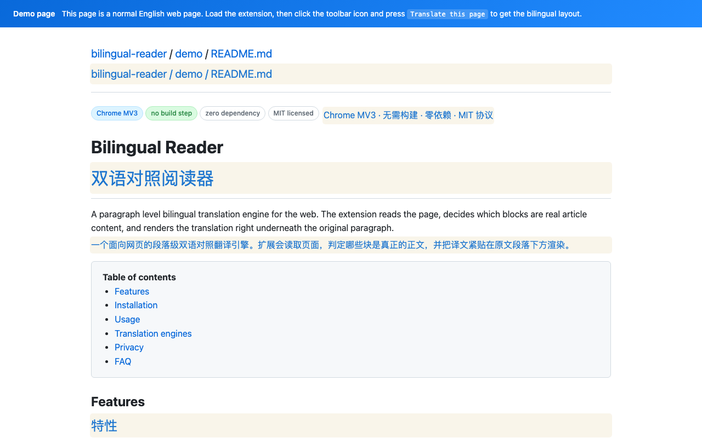
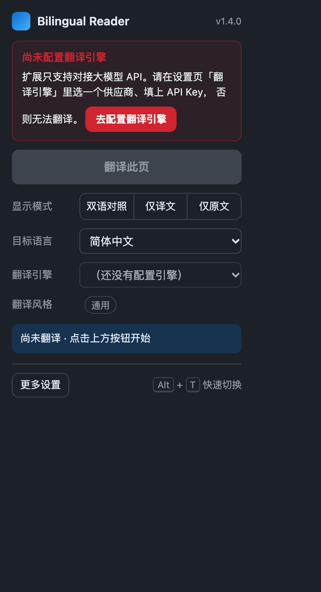
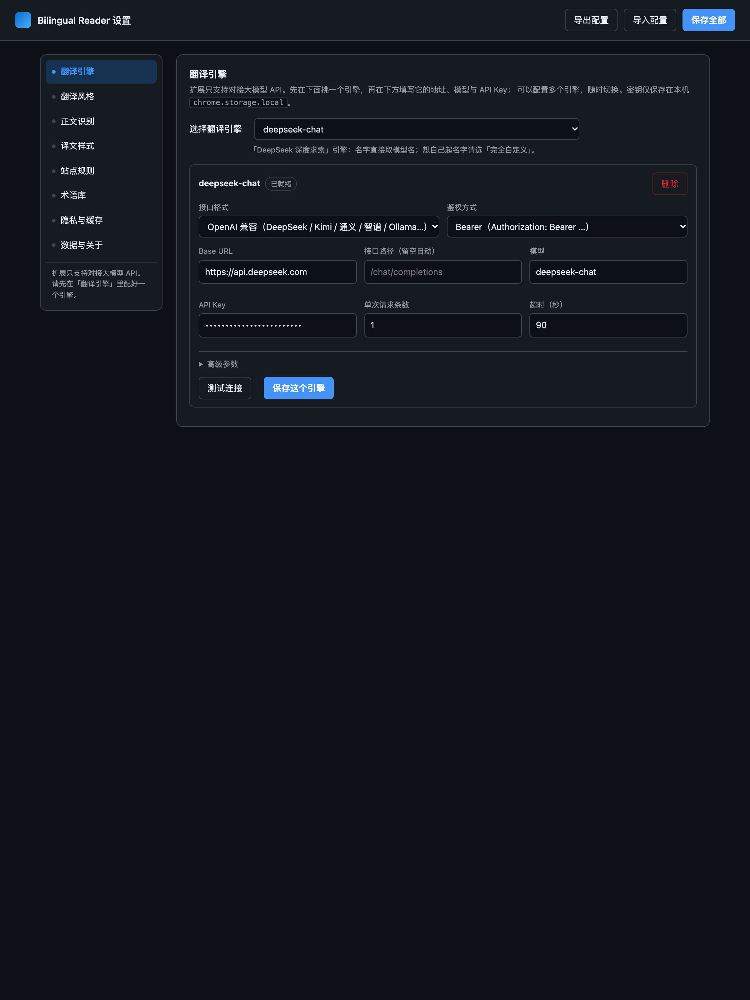

# Bilingual Reader · 双语对照翻译

[English](README.md) | **简体中文** | [日本語](README.ja.md) | [한국어](README.ko.md) | [Español](README.es.md)

**逐段对照阅读网页原文与译文。**

Bilingual Reader 是一个 Chrome 扩展：识别网页正文，把译文放在对应原文旁边。标题、列表和表格单元格都可以翻译，代码块保留原文。翻译使用你自己的模型 API 或本地部署的模型。

无需构建、无需安装 npm 依赖，也没有第三方运行时依赖。扩展界面目前以简体中文为主；这些 README 的语言版本介绍的是同一个扩展。

[项目主页](https://xuyang1996.github.io/bilingual-reader/zh-CN/) · [下载](https://github.com/xuyang1996/bilingual-reader/releases) · [隐私政策](https://xuyang1996.github.io/bilingual-reader/privacy.html) · [问题反馈](https://github.com/xuyang1996/bilingual-reader/issues)

## 效果预览



| 工具栏面板 | 设置页 |
| --- | --- |
|  |  |

## 功能

- **双语阅读**：切换双语对照、仅译文、仅原文，阅读结束后还原页面。
- **英语学习**：划选已翻译段落中的英文原文，可以拆解句子，也可以查看单词在原文中的释义、美式音标和构词。支持本地发音和收藏。
- **正文识别**：默认跳过导航、侧栏、页脚等页面框架，可通过站点规则调整范围。
- **懒翻译**：优先请求视口附近的内容，不一次性发送整页。
- **动态内容**：开启增量翻译后，自动补翻新插入的内容。
- **自备模型**：配置多个供应商、自建网关或本地模型服务。
- **翻译风格**：14 个内置场景、可编辑提示词、按网址自动匹配场景。
- **术语与隐私**：术语库提示、译后替换和可选的敏感信息脱敏。
- **本地配置和缓存**：设置与译文缓存在浏览器本地，支持 JSON 导入导出。

## 快速开始

1. 从 [Releases](https://github.com/xuyang1996/bilingual-reader/releases) 下载 **`bilingual-reader.zip`** 并解压，或克隆仓库。
2. 打开 `chrome://extensions`，开启**开发者模式**。
3. 点击**加载已解压的扩展程序**，选择包含 `manifest.json` 的目录，即解压后的 `bilingual-reader` 目录或仓库根目录。
4. 打开扩展设置，在**翻译引擎**中选择供应商，填写 API 地址、模型和 API Key，点击**测试连接**，再点击**保存这个引擎**。
5. 打开普通网页，点击扩展图标 → **翻译此页**。
6. 在工具栏面板中选择目标语言。默认目标为简体中文，列表包含 17 种目标语言。

主按钮下方的**暂停**会保留已有译文，取消正在发送和排队中的任务，并变为**继续**；点击继续，从暂停位置的上一段接着翻译。**重新翻译**会清除本页译文，跳过旧缓存，从第一段重新开始。**还原本页**则移除译文并结束本轮翻译。

在双语对照里，划选已翻译段落的一句英文原文，点击「学这句」即可打开解析卡。卡片会尽量避开当前原句和译文，按 Esc 或点击卡片外即可关闭。日常解析使用当前页面的模型配置。演示模式可以离线体验[内置例句和示例单词](https://xuyang1996.github.io/bilingual-reader/demo.html#study)。

划选一个单词可点击「查单词」，也可以展开句子卡里的「重点单词」。点击「发音」会使用设备上的英语语音。收藏的单词和句子可从扩展面板的「学习收藏」打开复习。

首次安装**没有配置任何引擎**。真实翻译需要可用的模型接口；扩展不提供托管翻译服务或 API 额度，供应商可能对请求收费。

也可直接点击普通网页右侧的 **「译」浮签**。浮签缩小为 32 像素，默认半透明，悬停时不透明；固定在右侧，只可上下拖动，高度会跨网页记忆。悬停或用键盘聚焦后，可暂停/继续、重译、还原、打开设置或关闭浮签。关闭后，在扩展面板点击 **显示网页浮签**，或在设置 → **译文样式** 中重新开启。

### 不用 API Key 先体验

在设置中添加**演示模式（本地示例，无需 Key）**并保存，然后打开[英文演示页](https://xuyang1996.github.io/bilingual-reader/demo.html)，启动翻译。

演示模式使用内置词表，在本地运行，不发网络请求，译文带浅黄底纹。它用于体验正文识别、排版、显示模式和还原流程，**不是真正的机器翻译**。

### 快捷键与右键菜单

| 操作 | 默认快捷键 |
| --- | --- |
| 翻译 / 还原当前页 | `Alt+T` |
| 开始翻译 | `Alt+Shift+T` |
| 还原页面 | `Alt+Shift+R` |

可在 `chrome://extensions/shortcuts` 修改快捷键。页面右键菜单也提供翻译、还原、仅译文和仅原文操作。

## 接入模型 API

引擎选择器提供 OpenAI、Anthropic Claude、Google Gemini、DeepSeek、Kimi、通义千问、GLM、OpenRouter 等供应商预设，本地预设包括 Ollama、vLLM 和 LM Studio。

| 接口 | 配置 |
| --- | --- |
| OpenAI 兼容 | Base URL、可选路径、模型和鉴权 |
| Anthropic Messages | Anthropic 请求格式和鉴权 |
| Gemini generateContent | Gemini 请求格式、模型路径和密钥设置 |
| 自定义 / 网关 | 自定义路径、请求头、额外请求体和响应字段路径 |
| 本地模型 | 本地服务地址和模型；仅在服务允许时使用免 Key 鉴权 |

预设推荐值以提示形式显示，请填写服务商实际要求的配置。预设引擎名跟随模型名；需要自行命名，或为同一模型配置多个网关时，请选择**完全自定义**并使用不重复的名称。

引擎层处理地址候选（包括缺少 `/v1`）、鉴权回退、多种响应结构和 SSE，并记住成功的地址与鉴权组合。编号批量回复无法对齐时回退为逐条请求。部分推理模型会依据模型名调整参数，实际兼容性仍取决于服务本身。

高级参数包括鉴权方式、system/developer/user 角色、超时、批量条数、温度、输出 token 上限、自定义请求头、额外 JSON 请求体、响应字段路径和系统提示词。[本地接口自测台](test/engine.html)可查看请求与响应细节；在扩展之外运行时可能受浏览器 CORS 限制。

翻译失败时，弹窗会显示接口错误。请先在设置中修正模型、鉴权或额度，再点击 **重试失败段落**，已成功的译文会保留。网络或接口临时故障最多自动重试两次；模型、地址或持续服务故障会暂停后续请求。详见[故障修复说明](docs/RELIABILITY.zh-CN.md)。

## 翻译风格

| 场景 | 重点 |
| --- | --- |
| 通用 | 忠实、简洁 |
| 科技 / 软件 | 技术术语与产品名 |
| 新闻 / 媒体 | 事实、引文和归属 |
| 学术论文 | 公式、引文与结论强度 |
| 编程文档 | API、命令和标识符 |
| GitHub | Issue、PR、Markdown 和代码 |
| 法律 | 定义术语与法律引用 |
| 医疗健康 | 医学术语、数量和单位 |
| 金融财经 | 数值、百分比和金融术语 |
| 电商购物 | 品牌、规格和购买条件 |
| 客服对话 | 保留语气与责任，不增加承诺 |
| 文学小说 | 人物口吻、节奏和叙事风格 |
| 社交媒体 | 口语、提及与话题标签 |
| 简明英语 | 将复杂英文改写成更易懂的英文 |

默认开启按网址自动匹配；命中场景会覆盖手选场景。可以修改内置提示词，也可以新增自定义场景。`{target}` 会替换为目标语言名。

引擎自定义系统提示词会覆盖场景和通用规则；未填写时，在通用规则后追加场景指令。使用批量协议时再追加编号要求，术语库指令最后追加。

## 站点规则与术语库

在**站点规则**中填写 JSON 数组，可以指定正文选择器、排除元素、修改语向或显示模式，以及覆盖识别阈值。支持网址通配符、`||example.com` 域名匹配和 `parentId` 继承；更具体的命中规则后应用。

```json
[
  {
    "id": "docs-site",
    "name": "Documentation",
    "urlPattern": ["*docs.example.com*"],
    "translationMode": "dual",
    "targetLang": "zh-Hans",
    "mainSelector": "main",
    "excludeSelectors": [".sidebar", "nav", ".advertisement"],
    "thresholds": { "paragraphMinTextCount": 2 }
  }
]
```

默认单段最少 2 字符，整页正文门槛为 50 字符。**整页翻译**会包括通常跳过的页面框架。内联技术片段使用占位符保护，独立代码块跳过。

术语库每行写一组原文和译法，以制表符或英文逗号分隔。例如：

```text
large language model,大语言模型
pull request,拉取请求
```

术语会写进模型提示词；译后处理还会替换残留的源术语，但不能保证纠正所有使用了其他目标译法的结果。

## 隐私与存储

- 作者不运营接收网页正文、API Key 或使用统计的服务器，没有广告或遥测 SDK。
- 真实翻译会将处理后的正文、提示词和鉴权信息**直接发送到你配置的接口**，适用该服务运营方的政策。请使用可信接口，远程服务使用 HTTPS。
- 点击「学这句」会向当前模型接口发送选中的原句和解析提示词。点击「查单词」会发送该词，并在可用时附上它所在的一句原文。请求沿用脱敏设置。主动收藏的学习内容保存在本机。
- 可选脱敏覆盖邮箱、电话、卡号、身份证号、IP、网址和 IBAN，基于规则匹配，**不保证移除全部敏感信息**。
- 配置、API Key 和译文缓存保存在 `chrome.storage.local`。缓存键包含文本、语向和引擎标识，超过 30 天后在读取时失效；可关闭或清空缓存。
- JSON 配置导出包含 API Key，请妥善保管。缓存和设置分别通过对应的设置控件清除，也可卸载扩展删除本地存储。
- 需要纯本地处理时，请使用演示模式或确实运行在本机的模型服务。选择“本地”预设本身不能决定自定义 URL 的数据去向。

详细说明见[完整隐私政策](https://xuyang1996.github.io/bilingual-reader/privacy.html)。

## 架构与开发

扩展采用 Manifest V3、classic JavaScript 脚本和共享的 `IMT` 命名空间。核心模块不依赖 `chrome.*`，翻译传输层可针对扩展或测试注入。

| 路径 | 职责 |
| --- | --- |
| `src/shared/` | 默认配置、供应商、工具、配置迁移和提示词 |
| `src/core/` | 规则、分段、调度、脱敏、术语和渲染 |
| `src/content/` | 页面指令与后台连接 |
| `src/background/` | API 适配、缓存、消息、快捷键和菜单 |
| `src/popup/`、`src/options/` | 工具栏面板与设置页 |
| `test/` | DOM 测试页、模拟模型服务和浏览器验证脚本 |
| `docs/` | 文档、截图和 GitHub Pages 资源 |

流程为：**解析规则 → 收集段落 → 调度 → 脱敏 → 缓存/API → 还原占位符 → 应用术语 → 渲染**。还原时解开原文包裹节点、删除译文；显示模式由 CSS class 控制。

修改后重新加载扩展，并刷新目标网页。较大改动前请阅读[开发文档](docs/DEVELOPMENT.md)、[产品需求](docs/PRD.md)和[原始详细技术说明](docs/README-technical.zh-CN.md)，其中保留了之前 README 的机制拆解与历史验证记录。

### 本地验证

仓库目录名为 `bilingual-reader` 时，先启动静态服务、打开 DOM 测试页，再在第二个终端的仓库根目录运行浏览器脚本：

```bash
git clone https://github.com/xuyang1996/bilingual-reader.git
cd bilingual-reader
python3 -m http.server 8766 --bind 127.0.0.1 --directory ..
```

`http://127.0.0.1:8766/bilingual-reader/test/harness.html?autotest=1`

```bash
python3 test/e2e.py --ext . \
  --url http://127.0.0.1:8766/bilingual-reader/demo/demo.html \
  --out /tmp/bilingual-reader-e2e.png
python3 test/verify_ai.py --ext .
python3 test/verify_reliability.py --ext .
python3 test/verify_floating.py --ext .
python3 test/verify_options.py --ext .
python3 test/verify_popup.py --ext . \
  --url http://127.0.0.1:8766/bilingual-reader/demo/demo.html
```

浏览器测试必须**串行执行**。脚本使用 Python 标准库，默认 Chrome 路径为 macOS 安装位置；其他环境可传入 `--chrome /path/to/chrome`。接口形态测试使用本地模拟 HTTP 服务，不调用付费供应商。

2026-11-04 的验证记录：**67 项 DOM 测试、35 项接口断言、53 项设置断言通过；工具栏面板验证通过；发布包译出 52 段，0 错误。** 这些是历史验证结果，不保证所有供应商的线上接口始终可用。

构建 Chrome 应用商店压缩包：

```bash
python3 test/build_store_zip.py --ext . --out ../bilingual-reader-store.zip
```

商店包的根目录为 `manifest.json`，排除测试、文档和商店素材。源码包则在 `bilingual-reader/` 下包含完整项目。

## 限制与参与贡献

- 本版本面向 Chrome / Chromium 的 Manifest V3（清单最低版本为 Chrome 96），尚不支持 Firefox 和 Safari。
- Chrome 内置页与应用商店页面无法翻译，无法访问 closed shadow root。
- React/Vue 频繁重渲染可能覆盖译文。正文识别采用启发式规则，特殊站点可能需要自定义适配。
- 供应商限流、额度、鉴权和服务可用性由供应商决定，各接口不一定支持所有高级参数。
- 修改模型、接口地址、提示词或术语库后，会自动使用独立的译文缓存。

欢迎通过 [Issues](https://github.com/xuyang1996/bilingual-reader/issues) 和 Pull Request 反馈或贡献。问题报告请尽量提供 Chrome 版本、复现步骤及公开示例网址，不要附带 API Key 或私密网页正文。

## 灵感与致谢

本项目的灵感来自 **[沉浸式翻译](https://immersivetranslate.com/)**。翻译风格使用了其公开的 **[immersive-translate/prompts](https://github.com/immersive-translate/prompts)** 中的场景提示词，并按本项目的需要做了适配。感谢沉浸式翻译团队及提示词贡献者。

## 许可

项目的 MIT 许可与来源说明见 [LICENSE](LICENSE)。
